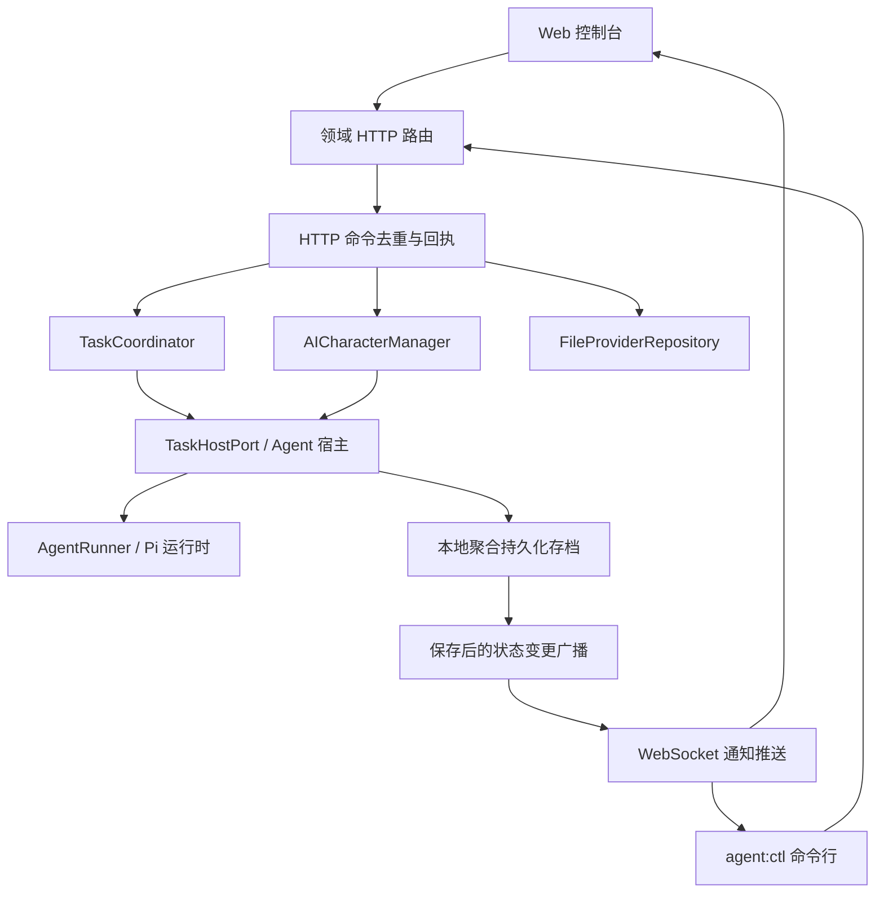

# Agent Gateway 管理接口

Agent Gateway 是管理 AI 角色生命周期、任务调度、模型配置与事件通知的中枢协议层。Web 控制台与 `agent:ctl` 命令行工具均共用这套统一的 HTTP RESTful 接口；而 `/ai-characters/gateway` WebSocket 仅负责单向推送实时状态变更通知，不再承载业务写入命令。



---

## 模块架构与代码归属

| 源码路径                                   | 架构层级   | 核心职责说明                                                 |
| ------------------------------------------ | ---------- | ------------------------------------------------------------ |
| `packages/shared/src/management.ts`        | 共享契约   | 管理公开视图、任务查询条件、命令回执与通知协议定义           |
| `packages/shared/src/management-client.ts` | 客户端 SDK | 浏览器与 Node.js 共用的 HTTP 请求封装及 WebSocket 断线重连   |
| `apps/server/src/modules/gateway`          | 传输层     | 管理员令牌校验与状态通知 WebSocket 客户端连接池管理          |
| `apps/server/src/modules/management`       | 领域协调   | HTTP 请求策略、错误码映射、命令去重队列与回执路由            |
| `apps/server/src/modules/ai-characters`    | 业务模块   | 角色生命周期（创建/加入/离开/删除）、配置与在线状态          |
| `apps/server/src/modules/tasks`            | 业务模块   | 任务计划编排、到期触发、执行控制（暂停/继续/取消）与历史记录 |
| `apps/server/src/modules/providers`        | 基础设施   | 大语言模型服务商配置、模型列表查询与连通性检测               |
| `apps/server/src/persistence`              | 持久化     | v3 聚合存档格式的原子文件写入、迁移编排与可见性提交          |
| `scripts/agent/agent-control.ts`           | 命令行运维 | `pnpm agent:ctl` CLI 的命令解析与终端交互输出                |

---

## 认证授权与跨域安全

所有管理接口均受到管理员 Bearer 令牌保护，严格限制跨域访问。

### 1. 令牌配置策略

服务按以下优先级读取管理员令牌：

1. **环境变量**：`AGENT_GATEWAY_TOKEN`
2. **文件读取**：`AGENT_GATEWAY_TOKEN_FILE`（未设置时默认使用 `.data/agent-gateway-token`）
3. **自动生成**：若文件不存在，服务端在启动时自动随机生成高强度令牌并写入文件（权限限定为 `0600`）

::: tip 查看本地令牌
在本地开发时，可直接通过 CLI 命令显式查看当前令牌：

```sh
pnpm agent:ctl auth show
```

开发模式（`NODE_ENV !== 'production'`）下运行 `pnpm dev` 时，服务端还会在启动终端直接打印管理员令牌，复制粘贴到网页「控制台」解锁框即可；生产环境不会打印令牌值。

:::

### 2. 跨域安全策略 (CORS)

- **严格白名单**：浏览器请求的 `Origin` 必须包含在 `AGENT_GATEWAY_ALLOWED_ORIGINS`（逗号分隔）中，**严禁使用 `*` 通配符**。
- **默认规则**：Docker 部署环境下默认放行 `http://localhost` 与 `http://127.0.0.1`。
- **免 Origin 鉴权**：本地 CLI 命令行工具无需携带 Origin 头，但必须提供合法 Bearer 令牌。

---

## HTTP 管理命令集

所有资源读写均通过标准 HTTP 请求完成，必须在 Header 中携带 `Authorization: Bearer <token>`：

| 业务领域     | HTTP 路由                  |           方法           | 功能说明                                |
| ------------ | -------------------------- | :----------------------: | --------------------------------------- |
| **AI 角色**  | `/ai-characters`           |      `GET` / `POST`      | 查询角色列表 / 创建新角色（保存即待命） |
|              | `/ai-characters/:id`       | `GET` / `PUT` / `DELETE` | 查看角色详情 / 更新参数 / 移除角色      |
|              | `/ai-characters/:id/join`  |          `POST`          | 指示已有角色加入当前游戏世界            |
|              | `/ai-characters/:id/stop`  |          `POST`          | 指示角色安全离开世界并暂停当前任务      |
|              | `/ai-characters/:id/voice` |          `POST`          | 即时开启或切换语音回复音色              |
| **模型服务** | `/providers`               |      `GET` / `POST`      | 查询模型服务商列表 / 添加新模型接口     |
|              | `/providers/:id`           |     `PUT` / `DELETE`     | 更新模型服务商凭据 / 删除未关联服务商   |
|              | `/providers/:id/models`    |          `GET`           | 实时探测并拉取该服务商支持的模型列表    |
| **任务安排** | `/tasks`                   |      `GET` / `POST`      | 分页检索任务计划 / 创建新任务安排       |
|              | `/tasks/:planId`           |          `PUT`           | 修改任务计划的后续触发规则              |
|              | `/tasks/:planId/run`       |          `POST`          | 立即手动发起一次任务执行（TaskRun）     |
|              | `/tasks/:planId/pause`     |          `POST`          | 暂停任务计划的自动调度                  |
|              | `/tasks/:planId/resume`    |          `POST`          | 恢复任务计划的自动调度                  |
|              | `/tasks/:planId/extend`    |          `POST`          | 追加周期任务计划的累计 Token 预算       |
| **任务执行** | `/tasks/:planId/runs`      |          `GET`           | 分页查看指定计划的历史执行记录          |
|              | `/task-runs/:runId/pause`  |          `POST`          | 暂停正在运行的任务（保留施工进度）      |
|              | `/task-runs/:runId/resume` |          `POST`          | 恢复已暂停的任务执行                    |
|              | `/task-runs/:runId/cancel` |          `POST`          | 取消终止当前任务执行                    |
| **命令回执** | `/management/commands/:id` |          `GET`           | 查询异步写命令的执行回执状态            |

---

## 幂等性与状态通知

### 1. 幂等性控制 (Idempotency)

- Web 控制台与 CLI 发起写操作时会自动附带 `Idempotency-Key` 请求头；
- 服务端内存维护最多 1,024 个命令回执（有效期 10 分钟），相同 Key 的重试请求直接返回已提交结果，避免网络抖动导致重复创建或扣费；
- 若并发提交相同 Key 但修改了请求内容，系统返回 `409 Conflict`。

### 2. WebSocket 实时状态通知

客户端连接 `ws://127.0.0.1:2567/ai-characters/gateway` 建立状态监听链路：

#### 握手帧 (Connect)

```json
{
  "type": "connect",
  "version": 3,
  "token": "<管理员令牌>"
}
```

#### 广播事件 (Events)

- **初始快照信号**：服务端认证通过后发送 `{ "type": "event", "event": "snapshot" }`，提示客户端通过 HTTP 拉取最新全量数据；
- **增量变更广播**：当角色、计划或任务状态变动持久化后，服务端广播 `{ "type": "event", "event": "changed", "data": { ... } }`，告知受影响的资源标识。

---

## 命令行运维 (CLI)

项目提供完整的 `agent:ctl` 命令行工具，支持在终端执行全量运维与状态监听：

```sh
# 1. 鉴权与状态查看
pnpm agent:ctl auth show              # 显式查看本地管理员令牌
pnpm agent:ctl list --json            # 查看所有角色列表（支持 JSON 输出）
pnpm agent:ctl status <characterId>   # 查看指定角色实时运行状态

# 2. 角色生命周期
pnpm agent:ctl join <characterId>     # 唤醒并加入世界待命
pnpm agent:ctl stop <characterId>     # 离开世界并暂停当前任务

# 3. 任务下发与控制
pnpm agent:ctl task create <characterId> --goal '巡视周边并建造一间小屋'
pnpm agent:ctl run pause <runId> --character <characterId>
pnpm agent:ctl run resume <runId> --character <characterId>
pnpm agent:ctl run cancel <runId> --character <characterId>

# 4. 计划检索与实时监听
pnpm agent:ctl plans [characterId]    # 查看计划列表
pnpm agent:ctl runs <characterId> <planId> # 查看执行历史
pnpm agent:ctl watch <characterId>    # 实时监听角色的事件与执行日志流
```

::: tip 通用参数支持
所有 `agent:ctl` 命令均支持 `--url <服务端地址>`、`--token-file <令牌路径>` 与 `--json` 输出控制。
:::

---

## 持久化存档与安全保障

- **管理数据存储**：模型服务配置、角色、任务计划、运行记录及请求映射分别保存在 PostgreSQL 中；旧 `.data/agent-providers.json*` 文件不会自动导入或删除；
- **原子提交机制**：角色与任务变更在同一数据库事务内提交，提交成功后才发布管理事件；
- **服务优雅关闭**：服务端接收到退出信号时，首先停止任务调度器，向正在运行的 Agent 下发取消动作并等待物理停止，随后持久化已暂停状态，最后安全关闭世界连接。
