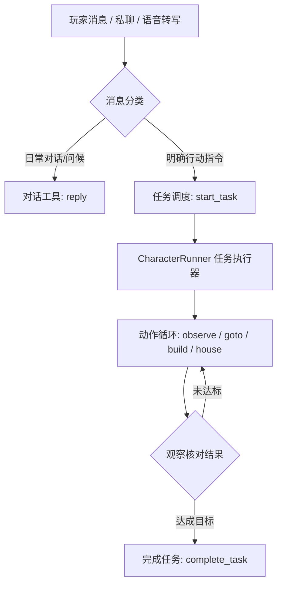

# 接入 AI 玩家

独立的本地多人 3D 体素世界支持通过大语言模型接入自主思考、移动寻路、对话与连续施工建造的 AI Agent。

> [!TIP] 推荐阅读
> Agent Gateway 管理入口、管理员令牌认证、WebSocket 状态广播和托管 CLI 详情请参阅 [📚 Agent Gateway 文档](/agent/gateway.md)。

---

## 架构与核心依赖

CLI 进程与服务端托管 Agent 共用 `@voxel/agent-runtime` 统一运行时中的 Pi 执行器。模型通过 `@earendil-works/pi-ai` 的 OpenAI-compatible 或 Gemini 原生流式工具接口接入；`pi-agent-core` 负责“推理 → 工具 → 结果 → 再推理”的决策循环，项目系统层负责权限边界、任务调度、预算控制与世界物理校验。

### 模块职责划分

| 模块目录                 | 核心职责                                           | 依赖与限制                                                  |
| ------------------------ | -------------------------------------------------- | ----------------------------------------------------------- |
| `scripts/agent`          | CLI 独立入口、环境变量解析与离线测试机器人         | 启动独立进程连接世界服务                                    |
| `packages/agent-runtime` | 世界会话客户端、动作执行、模型请求适配与任务编排   | 详见 [包内架构说明](../../packages/agent-runtime/README.md) |
| `apps/server`            | 联合持久化、角色生命周期、任务调度、唤醒与事件分发 | 统一由服务端权威管理                                        |

::: info 依赖与版本
模型接入依赖固定为 `@earendil-works/pi-ai@1.3.0` 与 `@earendil-works/pi-agent-core@1.3.0`。生产代码不依赖任何外部全局凭据，且不再使用旧版 `ModelPlanner` 或 `AGENT_ENGINE` 开关。
:::

---

## 大厅控制台（推荐接入）

通过 Web 控制台无需预先加入游戏即可统一管理 AI 角色、模型服务与任务计划。

### 1. 快速创建 AI 角色

1. **进入控制台**：在大厅中央点击 **创建 Agent 玩家**，或在右上角点击 **控制台**。
2. **选择或配置模型**：在 **创建 Agent** 表单内可直接选择已有服务商，或并行配置 DeepSeek、Gemini、Ollama（本机/局域网）或 OpenAI 兼容服务（密钥仅保存在服务端）。
3. **设置角色信息**：填写自定义昵称与可选的 **角色设定**（最多 2000 字）。
4. **配置技能与动作权限**：
   - 勾选内置技能（建筑规划、探索勘察、导览讲解）；
   - 动作权限中，“移动与跳跃”和“发送聊天”默认开启，“放置方块”和“拆除方块”按需开启。
5. **配置任务额度限制**：可通过独立开关开启或关闭执行约束；开启后可设定最大轮次、Token 预算及执行超时时间。
6. **创建与上线**：默认勾选“加入世界待命”。保存后屏幕顶部居中将弹出 Toast 浮动提示，并保持在当前配置页。

### Gemini 模型服务

在「模型服务」中新增服务并选择 **Gemini**，填写 Google AI Studio API Key；官方地址固定为 `https://generativelanguage.googleapis.com/v1beta`，默认模型为 `gemini-flash-lite-latest`。保存后点击「测试连接」读取可用于生成内容的模型列表，也可手动填写模型 ID。

角色运行使用 Gemini 原生 `streamGenerateContent`，保留工具调用的 thought signature 以支持多轮执行。对不能关闭思考的新模型，关闭思考会使用低强度；`max` 推理强度映射为 `high`。请求仍受任务预算和超时限制，不自动重试。模型列表可读取不代表该模型有可用的推理额度，实际可用性取决于密钥所属项目。

参考：[Google Gemini API](https://ai.google.dev/gemini-api/docs/text-generation)。

### 2. 角色设定与权限规范

#### 角色设定（System Prompt）

角色设定是 AI 长期遵守的身份与职责规范（最多 2000 字），例如：

> “你是一名资深建筑师，负责规划和建造房屋。施工前先确认位置、尺寸和风格，遇到障碍先说明情况，用简洁的中文向玩家汇报进度。”

修改设定随角色保存，重启后保留；单独修改设定不清空历史任务，也不赋予额外施工权限。

#### 动作权限矩阵

| 动作权限       | 默认状态 | 对应能力与影响                                                   |
| -------------- | :------: | ---------------------------------------------------------------- |
| **移动与跳跃** |   开启   | 允许执行 `goto`、`follow` 及基础移动物理模拟                     |
| **发送聊天**   |   开启   | 允许在公聊与私聊中发言；关闭后文字、自动回执与语音回复均停用     |
| **放置方块**   |   关闭   | 允许在世界中放置方块，是 `house` 蓝图与放置型 `build` 的必要前置 |
| **拆除方块**   |   关闭   | 允许清除世界中已有方块，拆除型 `build` 动作的必要前置            |

::: warning 权限与技能约束
技能属于提示词规划层面的专业指导，不会绕过权限校验。若技能所需权限未开启，模型施工时会被服务端权威拒绝，并在控制台报告权限错误。
:::

---

### 3. 任务额度与资源保护

AI 角色在执行任务时受到严格的资源保护机制约束，防止模型无限循环或消耗过多 API 额度：

| 额度配置项                         | 默认值  | 可配范围               | 说明                                  |
| ---------------------------------- | ------- | ---------------------- | ------------------------------------- |
| **执行限制开关**                   | 开启    | 开启 / 关闭            | 开启时生效以下阈值；关闭则无限制运行  |
| **调用保护上限 (`maxTurns`)**      | 100 次  | 1 ～ 1,000 次          | 单任务内模型调用的最大保护上限        |
| **Token 预算 (`tokenBudget`)**     | 50,000  | 1,000 ～ 100,000,000   | 单次任务执行允许消耗的最大 Token 总数 |
| **执行时间上限 (`taskTimeoutMs`)** | 15 分钟 | 1 分钟 ～ 6 小时       | 累计模型推理与动作执行的活跃耗时      |
| **重复计划累计预算**               | 500,000 | 1,000 ～ 1,000,000,000 | 针对周期/重复计划的总 Token 保护上限  |

- **预算达到处理**：达到上限后任务自动暂停，可在控制台任务执行中手动追加额度并继续。
- **Token 计算口径**：模型返回 usage 时记录真实消耗；无 usage 时根据上下文估算并标明。

---

### 4. 连续建造能力 (`house` 与 `build`)

开启“放置方块”权限后，所有服务商的 Agent 均支持单轮推理下发批量建造蓝图：

#### `house` 基础房屋蓝图

- **参数规格**：最小角坐标 `(x, y, z)`、宽度、深度、总高（宽/深 3–7 格，高 4–6 格）、材质与门朝向。
- **结构生成**：本地自动规划地板、空心墙体、平顶以及预留两格高的门洞，单蓝图上限 192 块。
- **障碍处理**：施工区域内若发现既有异物方块，施工器立即报告障碍并暂停，不会暴力破坏已有地形。

#### `build` 连续自定义施工

- **参数规格**：一次性提交 1–64 个具体方块的修改列表，坐标不可重复。
- **执行节奏**：批次内约每 **125 毫秒** 执行一块（约 8 块/秒），逐块等待服务端权威确认（距离、版本号、支撑与占用校验）。
- **断点续建**：若遭遇超出 6 格操作距离，记录已完成数量并交由模型重新规划站位后继续。

---

### 5. 对话与任务执行生命周期



- **对话与任务隔离**：对话模型使用独立 Pi 会话，仅能调用 `reply` 或任务控制工具；任务模型使用 `observe`、`goto`、`follow`、`build`、`house` 等物理工具。
- **即时打断指令**：当 Agent 正在执行任务时，若玩家发出“暂停”、“停止”、“别建了”、“取消任务”等明确文本，系统将在工具边界立即中断施工与请求。
- **消息排队机制**：执行过程中收到其他玩家消息会自动排队（上限 8 条并去重），待动作边界安全处理。
- **私聊边界隔离**：私聊布置的任务仅向该玩家汇报，其上下文对其他公共玩家完全隔离。

---

### 6. 任务计划与安排管理

一级导航的 **任务计划** 页面集中管理所有异步与周期调度任务：

#### 计划类型与触发方式

- **立即执行一次**：创建后即刻在角色在线且空闲时启动执行；
- **定时执行一次**：指定未来特定的日期和时间点触发；
- **固定间隔重复**：以创建时间为基准，按固定间隔周期循环；
- **每天 / 每周重复**：按指定时区的固定时钟或周几循环。

#### 计划与执行操作对照

| 操作分类       | 涵盖动作                                        | 行为与边界说明                                             |
| -------------- | ----------------------------------------------- | ---------------------------------------------------------- |
| **计划级操作** | 立即触发、暂停/启用、编辑、改派、追加额度、归档 | 仅影响未来触发；暂停计划不会强制杀死当前正在执行的 TaskRun |
| **执行级操作** | 暂停本次执行、恢复执行、取消终止                | 针对当前正在运行的 TaskRun；暂停会保留检查点与已施工方块   |

---

### 7. 数据持久化与故障恢复

- **存储位置**：Agent 角色与任务状态保存在 PostgreSQL；模型供应商配置和 API 密钥也保存在数据库中。原有 `.data/agent-providers.json*` 文件保留但不再读取。
- **冷启动恢复**：世界服务重启后，已上线的角色自动重新连接世界并恢复“待命（Idle）”状态；未完成任务自动转为“暂停”，不会意外重复扣除模型额度。
- **检查点安全**：每次世界写操作前均等待检查点持久化完成，防止服务器断电导致的世界状态与 Agent 记忆脱节。

---

### 8. 任务管理 API 参考

所有任务接口均遵循管理网关鉴权（需携带管理员 Bearer Token）：

| HTTP 路由                  |  方法  | 功能说明               | 核心参数 / 请求体                     |
| -------------------------- | :----: | ---------------------- | ------------------------------------- |
| `/tasks`                   | `GET`  | 分页查询所有任务计划   | 支持搜索、角色 ID、状态过滤           |
| `/tasks`                   | `POST` | 创建新任务计划         | 包含目标、执行角色、执行方式与 limits |
| `/tasks/:planId`           | `PUT`  | 修改任务计划的未来安排 | 支持更新目标与触发时钟                |
| `/tasks/:planId/run`       | `POST` | 立即手动触发一次执行   | 需提供幂等 `requestId`                |
| `/tasks/:planId/pause`     | `POST` | 暂停任务计划调度       | 停止后续自动触发                      |
| `/tasks/:planId/resume`    | `POST` | 恢复任务计划调度       | 计算未来下次时间，不补跑过期          |
| `/tasks/:planId/extend`    | `POST` | 追加任务计划总预算     | `{ "tokens": 100000 }`                |
| `/tasks/:planId/runs`      | `GET`  | 查询指定计划的执行记录 | 分页返回 TaskRun 列表                 |
| `/task-runs/:runId/pause`  | `POST` | 暂停当前执行中的任务   | 角色保留当前进度并待命                |
| `/task-runs/:runId/resume` | `POST` | 恢复已暂停的任务执行   | 需角色在线且空闲；可传入更高额度      |
| `/task-runs/:runId/cancel` | `POST` | 取消终止当前任务执行   | 将当前运行记录标记为取消              |

---

## DeepSeek 命令行模式（CLI 独立接入）

除 Web 控制台外，项目支持在终端作为独立 Node.js 进程运行纯命令行 AI 玩家。

### 1. 启动与运行

CLI 的角色、预算和模型选项通过命令行参数传入，不再读取 `.env` 的功能配置：

```sh
pnpm agent:ai --api-key sk-your-deepseek-api-key --model deepseek-flash --name DeepSeek --goal '探索附近环境，用中文简短介绍观察结果。'

# 部署地址仍可通过 SERVER_URL 指定
SERVER_URL=ws://127.0.0.1:2577 pnpm agent:ai --api-key sk-your-deepseek-api-key

# 无 LLM 的脚本巡逻机器人
pnpm agent:mock
```

可选参数：`--max-turns`（100）、`--token-budget`（50000）、`--task-timeout-ms`（900000）、`--interval-ms`（3000）、`--interval-mode`（fixed/random）、`--interval-min-ms`（4000）、`--interval-max-ms`（8000）、`--allow-edits`（true/false）、`--voice-replies`（true/false）。布尔选项需显式传入值，默认 false。

### 2. 思考模式

```sh
pnpm agent:ai --api-key sk-your-deepseek-api-key --thinking enabled --reasoning-effort high --max-tokens 4096 --timeout-ms 60000
```

`--thinking` 默认 disabled；启用后 `--max-tokens` 默认 4096，否则默认 512。`--reasoning-effort` 默认 high，`--timeout-ms` 默认 30000。

模型服务凭据、托管 Agent 行为和语音参数统一在 Web 控制台配置并持久化到数据库。

### 3. Agent 可执行动作清单

| 动作工具 | 参数格式                                             | 物理规则与行为边界                                         |
| -------- | ---------------------------------------------------- | ---------------------------------------------------------- |
| `wait`   | `{}`                                                 | 结束当前动作轮次，原地等待下一次观察唤醒                   |
| `chat`   | `{ "text": "..." }`                                  | 发送 1–240 字符的公开广播聊天消息                          |
| `goto`   | `{ "x": number, "y": number, "z": number }`          | 前往指定坐标；支持绕障、单格台阶攀爬与下落，默认 30 秒超时 |
| `follow` | `{ "playerId": string, "distance": number }`         | 持续跟随目标玩家（保持 0.8–4 格距离），目标超出后自动推进  |
| `house`  | `{ "min": [...], "size": [...], "material": "..." }` | 规划并批量建造空心带门小房屋（宽深 3–7，高 4–6）           |
| `build`  | `{ "edits": [...] }`                                 | 批量编辑 1–64 个方块坐标与材质（需开启对应编辑权限）       |
| `edit`   | `{ "x", "y", "z", "material" }`                      | 单块破坏或放置，需服务端 CAS 版本号校验                    |

---

## Pi 迁移与基准验收

### 真实模型基准对比

使用真实 `deepseek-flash` 模型在固定内存世界中对六类典型场景（每类 5 次）进行自动化基准实测：

| 场景分类     | 旧版架构成功率 | Pi 统一运行时成功率 | 中位请求数 (旧 → Pi) | 中位 Token (旧 → Pi) | 中位耗时 (旧 → Pi) |
| ------------ | :------------: | :-----------------: | :------------------: | :------------------: | :----------------: |
| **日常聊天** |      5/5       |       **5/5**       |        1 → 1         |    3,845 → 3,231     |  1,108ms → 912ms   |
| **路径移动** |      4/5       |       **5/5**       |        5 → 2         |    19,788 → 6,957    | 6,316ms → 2,369ms  |
| **结构建造** |      5/5       |       **5/5**       |        2 → 2         |    7,998 → 7,032     | 2,373ms → 2,222ms  |
| **故障纠错** |      4/5       |       **5/5**       |        4 → 4         |   15,807 → 15,906    | 3,938ms → 3,335ms  |
| **原地等待** |      5/5       |       **5/5**       |        1 → 1         |    3,798 → 3,241     |   988ms → 913ms    |
| **中途修改** |      5/5       |       **5/5**       |        4 → 4         |   16,145 → 14,493    | 3,981ms → 3,994ms  |

基准测试复现命令：

```sh
pnpm exec tsx tests/benchmarks/pi-agent.ts
```

详细验证报告与回退演练请查阅 [📚 验证记录文档](/changelog/validation.md)。
