# 详细架构图

本文用一组 Mermaid 图从多个层级描述 EmboCraft 的架构：部署拓扑 → Monorepo 依赖 → 服务端装配 → 网络入口 → 前端分层 → Agent 运行时 → 关键时序 → 持久化。文字说明见 [项目架构与代码组织](./architecture.md)。

---

## 1. 系统全景与部署拓扑

对应 `docker-compose.yml`：`web`（Nginx 托管静态资源并反代）、`server`（Node 单进程）、`speech`（Whisper/Piper 语音服务）、`db`（PostgreSQL 17）。

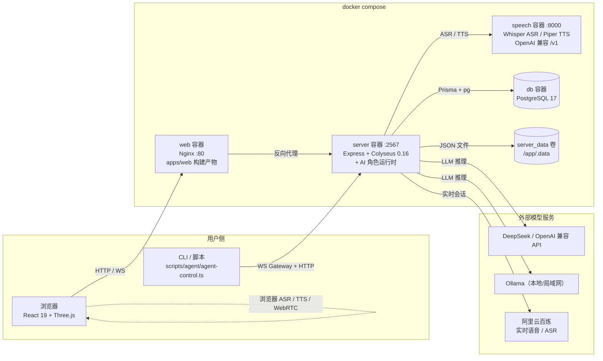

---

## 2. Monorepo 包依赖

```mermaid
graph TD
    Web["@voxel/web<br/>apps/web"]
    ServerPkg["@voxel/server<br/>apps/server"]
    Runtime["@voxel/agent-runtime<br/>packages/agent-runtime"]
    Shared["@voxel/shared<br/>packages/shared（零依赖）"]
    Docs["@voxel/docs<br/>docs（VitePress）"]
    Scripts["scripts/agent<br/>tests/benchmarks"]

    Web --> Shared
    ServerPkg --> Runtime
    ServerPkg --> Shared
    Runtime --> Shared
    Scripts --> Runtime
    Scripts --> Shared

    Web -.->|colyseus.js / three / i18next / radix-ui| WebLibs(("第三方"))
    ServerPkg -.->|@colyseus/core / express / prisma / ws / swagger| SrvLibs(("第三方"))
    Runtime -.->|pi-agent-core / pi-ai / openai / colyseus.js| RtLibs(("第三方"))
```

`@voxel/shared` 内部按领域拆分子模块：

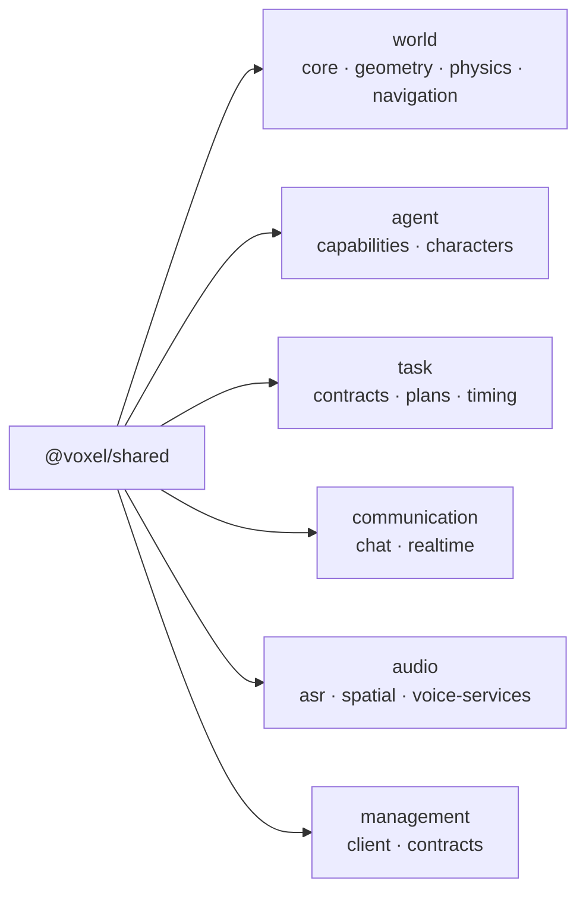

---

## 3. 服务端装配（`apps/server/src/server.ts`）

`createServer()` 是唯一的组合根：加载存储 → 构建领域服务 → 组装 HTTP 与 Socket 路由 → 定义 Colyseus 房间。

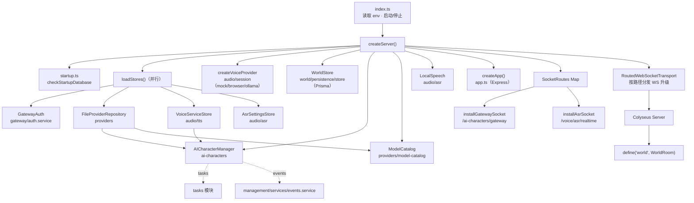

### 服务端模块全景

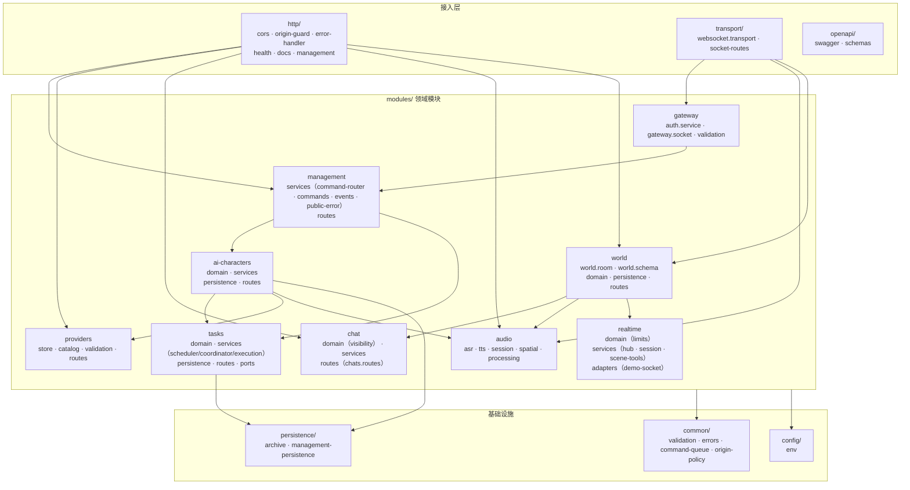

### AI 角色模块内部（`modules/ai-characters`）

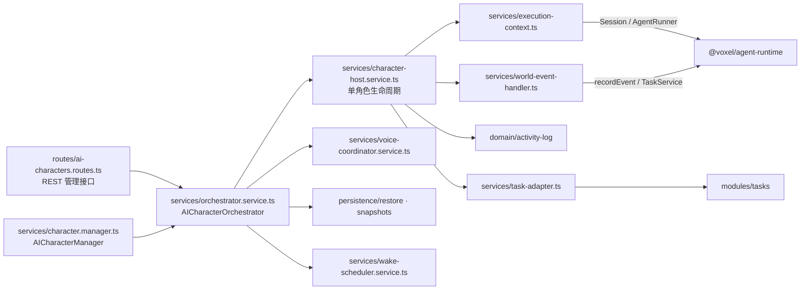

---

## 4. 网络入口与协议

单个 HTTP 端口（默认 `2567`）同时承载 REST、SSE 与多路 WebSocket。

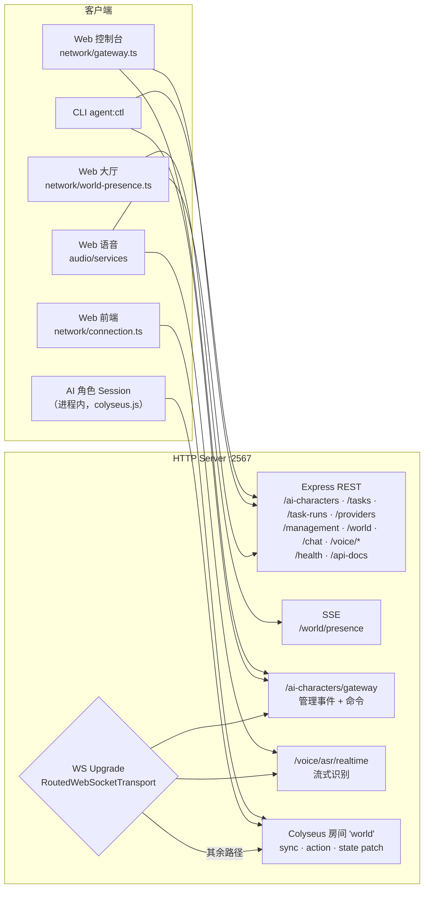

`WorldRoom` 的 `action` 消息按 `type` 分发：

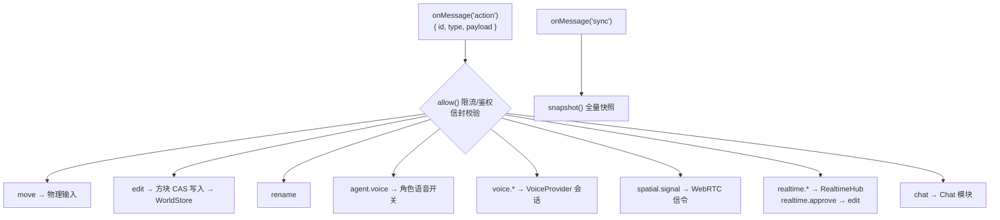

---

## 5. 前端分层（`apps/web/src`）

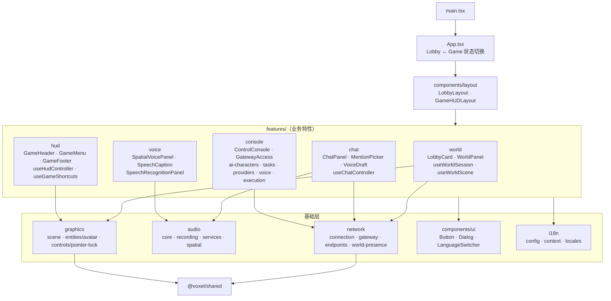

---

## 6. Agent 运行时（`packages/agent-runtime`）

感知 → 认知 → 决策 → 行动 的分层，任务与预算贯穿其中。

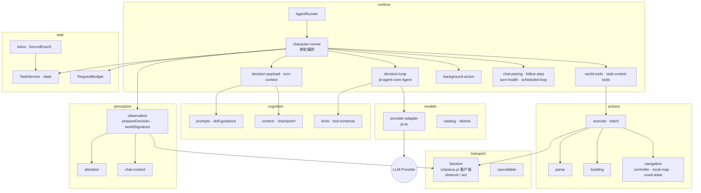

---

## 7. 关键时序

### 7.1 AI 角色一次决策轮次

```mermaid
sequenceDiagram
    autonumber
    participant Room as WorldRoom
    participant Host as CharacterHost
    participant Runner as AgentRunner / character-runner
    participant Loop as decision-loop (pi-agent-core)
    participant LLM as LLM Provider
    participant Tools as world-tools / actions
    participant Task as TaskService

    Room-->>Host: 世界事件（聊天 @、方块变化、玩家靠近）
    Host->>Task: recordEvent → inbox
    Host->>Host: wake-scheduler 唤醒
    Host->>Runner: run(turn)
    Runner->>Room: Session.observe()（快照 / 局部地图）
    Runner->>Runner: prepareDecision + buildDecisionPayload
    Runner->>Loop: runDecisionLoop(prompt, tools, budget)
    loop 工具调用轮次（受 RequestBudget 限制）
        Loop->>LLM: chat completion（stream）
        LLM-->>Loop: tool_call
        Loop->>Tools: move / navigate / build / say ...
        Tools->>Room: action 消息
        Room-->>Tools: reply + state patch
        Tools-->>Loop: ActionResult
    end
    Loop-->>Runner: 结果 / checkpoint
    Runner->>Task: 更新任务状态
    Runner-->>Host: 轮次完成
    Host-->>Host: activity-log + management events → Gateway 推送控制台
```

### 7.2 玩家放置方块

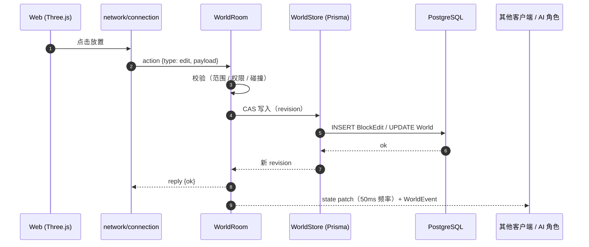

### 7.3 控制台管理命令

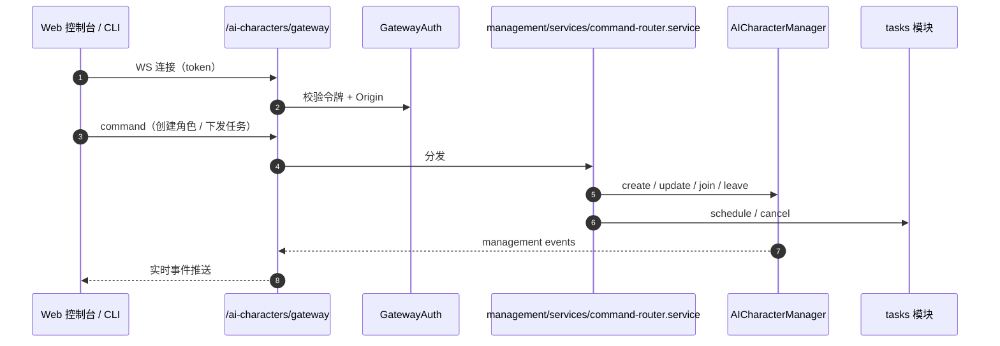

---

## 8. 持久化与数据流

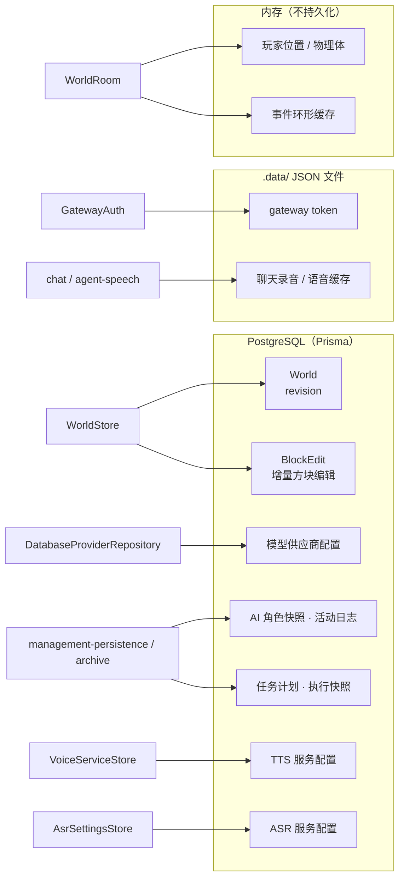

> 服务需要 PostgreSQL。模型供应商、Agent 与 TTS/ASR 服务配置保存在数据库；网关令牌及本地语音模型文件仍保存在 `server_data` 卷（容器内 `/app/.data`）。旧语音配置文件不会自动导入。
