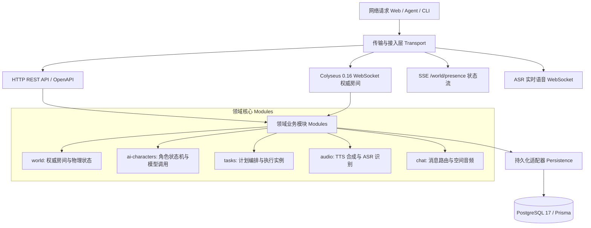
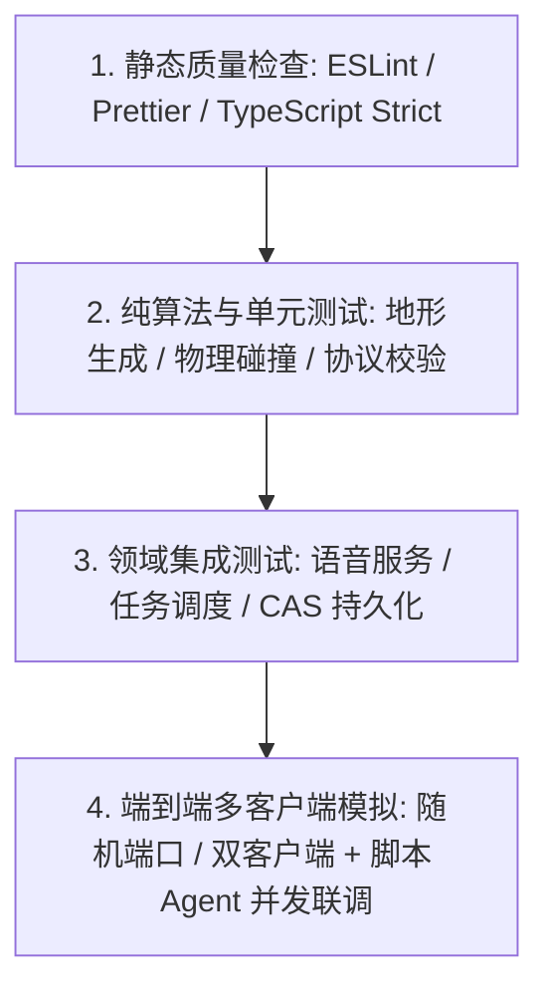

# 项目架构与代码组织

本文档详细说明 EmboCraft 的整体软件架构、分层模型、Monorepo 目录组织以及服务端与前端的代码工程实践。

::: tip 架构定位与系统边界

- **系统类型**：本地单进程、单房间、权威物理同步的轻量体素多 Agent 协作沙盒原型系统。
- **空间规格**：世界水平网格尺寸为 **49×49**（坐标闭区间 `[-24, 24]`），垂直高度上限为 **15**。
- **持久化分层**：PostgreSQL 保存方块增量编辑、模型供应商、Agent 角色与任务及 TTS/ASR 服务配置；玩家位置、事件环形缓存及聊天录音暂不持久化至数据库。服务启动需要可用的数据库。
- **并发容量**：单世界最多支持 16 个并发活跃网络会话（真人或 Agent）。
  :::

---

## Monorepo 模块分工

项目基于 `pnpm workspace` 组织为多包协作架构，核心目录分布如下：

```
embocraft/
├── apps/
│   ├── web/               # 前端：React 19 + Three.js 体素渲染 + WebRTC/Web Audio
│   └── server/            # 服务端：Colyseus 0.16 权威世界 + Express + Prisma ORM
├── packages/
│   ├── shared/            # 跨端共享：网络协议定义、确定性地形算法、AABB 物理碰撞
│   └── agent-runtime/     # 统一 Agent 运行时：状态感知、A* 寻路、LLM 规划与任务状态机
├── scripts/
│   └── agent/             # CLI 脚本：Scout 巡逻机器人、CLI AI 玩家与自动化测试工具
└── docs/                  # 基于 VitePress 的完整技术与协议规范文档
```

### 核心包职责矩阵

| 包路径                       | 命名空间               | 关键职责与技术选型                                                                                                          |
| :--------------------------- | :--------------------- | :-------------------------------------------------------------------------------------------------------------------------- |
| **`apps/web`**               | `@voxel/web`           | 基于 React 19 构建游戏 HUD、管理控制台；通过 Three.js 实例化网格（InstancedMesh）高效渲染体素，接入 WebRTC 与 3D 空间音频。 |
| **`apps/server`**            | `@voxel/server`        | 负责 20Hz 权威房间模拟、方块编辑 CAS 乐观锁写入、Whisper/Piper 语音中继分发、管理网关与任务计划调度。                       |
| **`packages/shared`**        | `@voxel/shared`        | 纯 TypeScript 跨端库，零外部重量依赖。包含世界常量、确定性噪声地形生成器、物理 AABB 包围盒判定及协议白名单。                |
| **`packages/agent-runtime`** | `@voxel/agent-runtime` | 封装 Agent 与世界的连接、三维空间密集 A\* 寻路、双层观察空间转换、模型思考轮次调度与连续动作执行器。                        |

---

## 服务端分层架构 (`apps/server`)

::: tip 深入了解
更细粒度的目录树拓扑、9 大业务模块职责边界与统一治理规范，请参阅专门文档 **[服务端目录架构与设计规范](./server-structure.md)**。
:::

服务端采用领域驱动设计（DDD）的思想，将网络传输层、应用装配层、业务领域模块与持久化存储严格分离：



### 核心领域模块清单

| 模块目录                    | 领域职责与关键抽象                                                                     |
| :-------------------------- | :------------------------------------------------------------------------------------- |
| **`modules/world`**         | 维护 Colyseus 房间状态、方块修改队列、乐观版本锁（CAS）与世界全量快照生成。            |
| **`modules/ai-characters`** | 统一管理游戏内 AI 角色配置、模型供应商绑定、上线待命及自主发声状态。                   |
| **`modules/tasks`**         | 实现任务计划（Plan）与运行实例（Run）的分层管理，提供取消、暂停、恢复与检查点追踪。    |
| **`modules/audio`**         | 统一抽象 Piper 本地引擎、阿里云百炼 TTS、OpenAI-Compatible 接口与 Whisper 语音流处理。 |
| **`modules/chat`**          | 管理公开群聊广播、私信 ACL 过滤、WebRTC 空间信令代理与附近语音流式转写。               |
| **`modules/gateway`**       | 提供管理员 Bearer 鉴权、CORS 校验与全双工管理通知 WebSocket。                          |

### 服务端生命周期管理

- **`createApp()`**：纯函数式组装 Express 应用中间件及业务路由，不触发端口监听或数据库连接，专供单元与路由测试使用。
- **`createServer()`**：系统装配中心，加载环境变量、初始化数据库客户端、装配 Colyseus 房间、Agent 运行时与音频队列。
- **`listen()`**：绑定端口、加载世界存档并触发已保存 Agent 的自动唤醒与上线。
- **`close()`**：幂等且安全的优雅停机函数。按顺序停止 Agent 调度、关闭 Colyseus 房间、终止 ASR 长连接、断开数据库连接并释放内存资源。

---

## 前端功能架构 (`apps/web`)

前端以“特性驱动（Feature-Driven）”的方式划分模块，杜绝跨功能深层紧耦合：

```
apps/web/src/
├── features/
│   ├── console/            # 管理控制台：AI 角色配置、任务列表、语音服务面板
│   ├── chat/               # 多模态聊天：群聊/私信切换、@ 自动补全、录音草稿
│   ├── hud/                # 游戏 HUD：准星、材质快捷栏、按键引导、顶部状态栏
│   ├── voice/              # 附近空间语音：麦克风/收听开关、Web Audio 声相调节
│   └── world/              # 玩家感知：实时在线列表、重连提示
├── graphics/               # 渲染管线：Three.js 场景、体素网格、角色模型、3D 头顶字幕
├── audio/                  # 音频设施：Web Audio API 上下文、PCM Worklet 录音采集器
└── network/                # 通信设施：Colyseus 客户端封装、API 请求端点与 SSE 订阅
```

### 关键工程原则

1. **控制器模式（Controller Pattern）**：
   - 复杂界面状态统一由自定义 Hook 控制器收敛（如 `useConsoleController`、`useChatController`），UI 组件仅作为纯展示层接收状态与回调。
2. **三维空间音效与 3D 字幕映射**：
   - 空间音频衰减计算由 `features/voice` 结合玩家实时坐标执行；
   - 3D 头顶字幕气泡利用 Three.js 的矩阵变换，将体素模型头部坐标动态映射至屏幕二维坐标系，兼顾沉浸感与字体清晰度。
3. **音频 Worklet 物理隔离**：
   - PCM 采集采用 `AudioWorkletNode` 在独立音频渲染线程中执行，彻底避免主线程 UI 渲染卡顿引发的丢帧爆音。
4. **重型模块按需加载**：
   - 管理控制台通过 `React.lazy` + `Suspense` 独立分包，仅在首次打开时下载，关闭后保持挂载以保留界面状态；
   - i18n 词条按语言拆分为独立 chunk，首屏只加载当前语言，切换语言时再按需拉取其余词典。

---

## 质量保障与测试金字塔

项目建立了全方位多层次的测试验证体系，涵盖静态质量、单元测试、领域集成与端到端多端网络同步：



### 质量检验指令全集

| 检验命令                    | 涵盖范围与执行标准                                                                                    |
| :-------------------------- | :---------------------------------------------------------------------------------------------------- |
| **`pnpm check`**            | 统一运行全仓代码规范、TypeScript 编译检查、前端单元测试及生产构建打包。                               |
| **`pnpm lint`**             | 对全部应用、共享包及自动化测试脚本执行 ESLint 规则检查。                                              |
| **`pnpm format:check`**     | 严格校验代码格式化的一致性（基于 Prettier）。                                                         |
| **`pnpm test:integration`** | 启动临时沙箱服务端，模拟多个真人与 Agent 客户端并发进入世界，覆盖方块争用、私聊隔离、断线恢复等场景。 |
| **`pnpm test:agents`**      | 针对托管 AI 角色与任务编排执行全生命周期自动化集成测试。                                              |
