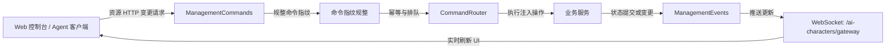

# 服务端目录架构设计标准

本文档定义了 `@voxel/server`（`apps/server`）的**目录架构全景与分层设计标准**，采用清晰规范的**模块化单体（Modular Monolith）**工程规范。

::: tip 核心设计原则

1. **Core 与 Modules 严格分立**：非业务的通用平台底座统一收归 `src/core/`；所有具体沙盒与智能体业务逻辑严格在 `src/modules/<domain>/` 内部自闭环。
2. **持久化职责清晰分层**：单一模块私有数据存储严格内聚于各模块的 `persistence/`；跨模块联合存档归入 `src/persistence/`，数据库客户端、连接池及探活归入 `src/core/database/`。
3. **业务路由内聚装配**：业务接口由各模块内部自治管理并导出挂载契约，顶层 `app.ts` / `server.ts` 仅负责声明式装配。
4. **统一模块门面导出**：所有模块对外统一通过根部 `index.ts` 暴露公共接口，严禁跨模块深层相对路径引用（No Deep Import）。
5. **统一文件命名与就近测试**：路由统一为 `*.routes.ts`，Socket 统一为 `*.socket.ts`，业务服务通常为 `*.service.ts`，保留 `character.manager.ts`、`world.room.ts`、`world.schema.ts` 等职责明确的命名；单元测试与源码同目录就近共置（`*.test.ts`），跨模块集成与架构测试另行集中。
6. **API 静态契约 100% 覆盖**：显式注册的 REST 路由维护对应的 OpenAPI JSDoc 注解；AST 检查当前支持的 `app.get/post/put/patch/delete` 静态路径及数量一致性，检查范围与限制见第 5 节。
7. **数据持久化安全保障**：PostgreSQL 强校验作为生产核心数据底座，启动前严格探活与脱敏；全局快照使用关系表驱动，离线测试显式注入内存存储。
   :::

---

## 1. 当前服务端目录结构

以下列出已落地的主要目录与文件，不是完整文件清单；部分测试和辅助文件省略。服务端使用仓库根部的 `tsconfig.json`。本轮目录与命名整理已完成，后续职责拆分应单独评估。

数据库基础设施位于 `core/database/`，跨模块联合存档位于 `src/persistence/`，九个业务模块按职责组织领域规则、服务、存储和协议适配。原 `audio` 模块已拆分：ASR 归 `modules/asr`，TTS 与音色服务归 `modules/tts`，Agent 发声与空间信令归 `modules/world/services/`，两者共用的无状态音频基础设施归 `core/audio/`。模块之间通过各自的 `index.ts` 引用。具体兼容约定见仓库内的 `apps/server/README.md`。

```text
apps/server/
├── prisma/                              # Prisma ORM 定义与迁移（PostgreSQL 全局领域存储）
│   └── schema.prisma                    # 全局关系表定义（World/BlockEdit、Provider、Character、Task/Run、TTS/ASR）
├── package.json                         # 服务端运行时与依赖
└── src/
    ├── index.ts                         # 服务进程入口（环境变量载入、CLI诊断、优雅停机）
    ├── server.ts                        # 复合网络装配器（HTTP + Colyseus + WebSocket 升级路由）
    ├── app.ts                           # Express REST API 装配器（挂载中间件与各模块路由）
    │
    ├── core/                            # ════════【平台基础设施层（与游戏业务无关）】════════
    │   ├── config/                      # 强类型配置
    │   │   ├── env.ts                   # 环境变量校验与解析（dotenv）
    │   │   └── index.ts                 # 配置聚合导出
    │   ├── database/                    # 基础设施数据库连接与健康检查
    │   │   ├── client.ts                # PrismaClient 与 Pg 适配器统一工厂（调用方拥有连接）
    │   │   ├── health.ts                # 启动前只读探测与异常凭据脱敏（checkStartupDatabase）
    │   │   └── health.test.ts
    │   ├── concurrency/                 # 跨模块并发与异步队列调度原语
    │   │   └── command-queue.ts         # 有状态并发锁与 FIFO 指令执行队列
    │   ├── errors/                      # 全局统一异常模型
    │   │   └── app-error.ts             # AppError 类与 HTTP 状态码映射
    │   ├── http/                        # HTTP 基础能力与中间件管道
    │   │   ├── cors.ts                  # CORS 跨域策略
    │   │   ├── validation.ts            # 请求体/参数校验守卫与类型收窄
    │   │   ├── origin-policy.ts         # Origin 策略计算
    │   │   ├── origin-policy.test.ts
    │   │   ├── routes/                  # 基础设施级路由（非业务模块）
    │   │   │   └── health.routes.ts     # /health 探针
    │   │   └── middleware/              # 通用 HTTP 中间件
    │   │       ├── async-route.ts       # 异步路由捕获包装
    │   │       ├── error-handler.ts     # 全局错误捕获响应中间件（屏蔽未捕获异常堆栈）
    │   │       ├── origin-guard.ts      # 请求 Origin 安全防护
    │   │       └── require-json.ts      # 变更操作 Content-Type: application/json 守卫
    │   ├── openapi/                     # Swagger / OpenAPI 契约体系（Spec、UI 与测试内聚）
    │   │   ├── swagger.ts               # Swagger 规范生成
    │   │   ├── swagger.test.ts          # 【静态门禁】基于 AST 验证 100% 路由覆盖率
    │   │   ├── openapi-schemas.ts       # 通用 DTO Schema 声明
    │   │   └── docs.routes.ts           # /api-docs 与 /api-docs.json UI 文档路由
    │   ├── transport/                   # 网络传输复合多路复用底座
    │   │   ├── socket-routes.ts         # Socket 路由契约（SocketHandler, SocketRoutes）
    │   │   └── websocket.transport.ts   # RoutedWebSocketTransport（拦截升级，共享端口与心跳）
    │   └── audio/                       # ASR/TTS 共用的无业务状态音频基础设施
    │       ├── pcm-wav.ts               # PCM WAV 格式、时长与音量校验（无 I/O）
    │       ├── normalize.ts             # 录音/合成音频 FFmpeg 规整与临时文件生命周期
    │       ├── normalize.test.ts
    │       ├── command.ts               # 子进程执行与可执行文件查找
    │       ├── speech-endpoint.ts       # 部署默认的语音服务地址
    │       ├── speech-endpoint.test.ts
    │       ├── speaches-models.ts       # Speaches 模型与音色发现
    │       ├── speaches-models.test.ts
    │       └── voice-service-connection.ts # ASR/TTS 共用连接参数校验
    │
    ├── persistence/                     # ════════【全局数据快照与持久化底座】════════
    │   ├── archive.ts                   # 跨模块快照契约（ArchivePort, ManagementArchive）
    │   ├── database-archive.ts          # 【生产主干】PostgreSQL + Prisma 关系表快照驱动
    │   ├── management-persistence.ts    # 跨模块快照串行提交与 storageRevision 失败代次
    │   └── migrate-archive.ts           # 存档结构校验与历史版本迁移
    │
    └── modules/                         # ════════【业务领域模块层（各领域自闭环）】════════
        │
        ├── ai-characters/               # ── 1. 具身智能体生命周期与宿主 ──
        │   ├── domain/                  # 智能体领域实体、状态规则与纯计算
        │   │   ├── validation.ts        # 角色配置合法性纯校验
        │   │   └── activity-log.ts      # 动作日志格式纯函数
        │   ├── services/                # 核心编排服务与 Actor 运行时
        │   │   ├── character.manager.ts # 智能体总管服务（AICharacterManager）
        │   │   ├── orchestrator.service.ts # 意图与动作编排服务
        │   │   ├── character-host.service.ts # 单智能体 Actor 宿主与执行上下文
        │   │   ├── wake-scheduler.service.ts # 定时与事件唤醒调度器
        │   │   ├── voice-coordinator.service.ts # 语音协同调度服务
        │   │   ├── job.ts               # 托管运行时状态、集合与状态判定
        │   │   ├── execution-context.ts # 会话与 Runner 执行上下文契约
        │   │   ├── task-adapter.ts      # 将角色运行时状态适配为 Tasks 执行状态
        │   │   └── world-event-handler.ts # 世界事件接收与角色唤醒协调
        │   ├── persistence/             # 角色配置存储与快照捕获（Snapshots）
        │   │   ├── queries.ts           # HTTP 直接数据库查询、详情组装与日志分页
        │   │   ├── snapshots.ts         # 角色快照捕获
        │   │   ├── restore.ts           # 历史快照还原
        │   │   └── record.ts            # 运行时持久化记录映射
        │   ├── ports.ts                 # 依赖端口抽象契约
        │   ├── routes/
        │   │   └── ai-characters.routes.ts
        │   └── index.ts                 # 模块对外面向 server.ts/app.ts 的唯一导出
        │
        ├── asr/                         # ── 2. 语音识别（ASR） ──
        │   ├── services/                # 识别引擎与调度
        │   │   ├── local-speech.service.ts # LocalSpeech：Whisper API 识别
        │   │   ├── bailian.service.ts   # 百炼 WebSocket 协议桥接
        │   │   ├── speech-scheduler.service.ts # 识别队列、超时与取消
        │   │   ├── transcript.ts        # Whisper 转写结果解析
        │   │   └── whisper-settings.ts  # Whisper 配置校验
        │   ├── persistence/             # ASR 配置存储及数据库适配
        │   │   ├── asr-settings-store.ts # AsrSettingsStore：配置与识别占用
        │   │   └── database-asr-services.ts
        │   ├── routes/
        │   │   ├── asr.http.ts          # installAsrHttp：保留鉴权与路由安装顺序
        │   │   ├── asr.routes.ts        # /voice/asr/* 识别服务管理
        │   │   ├── transcribe.routes.ts # /voice/transcribe 音频转写
        │   │   └── capabilities.routes.ts # /voice/capabilities 运行时能力探针
        │   ├── sockets/
        │   │   └── asr.socket.ts        # /voice/asr/realtime 实时流式识别
        │   └── index.ts                 # installAsrHttp、installAsrSocket、LocalSpeech 等
        │
        ├── tts/                         # ── 2b. 语音合成（TTS）与音色服务 ──
        │   ├── services/
        │   │   ├── piper.service.ts     # PiperTts 合成
        │   │   ├── remote.service.ts    # RemoteTts 远程合成
        │   │   ├── piper-models.service.ts # Piper 模型就绪查询
        │   │   └── speech-synthesizer.ts # 合成接口与结果类型
        │   ├── persistence/
        │   │   ├── voice-service-store.ts # VoiceServiceStore：配置、绑定与合成协调
        │   │   └── database-voice-services.ts
        │   ├── routes/
        │   │   ├── tts.http.ts          # installTtsHttp：经 management 管线挂载 /voice/tts
        │   │   └── voice-services.routes.ts # /voice/tts/services 管理与试听
        │   └── index.ts                 # installTtsHttp、VoiceServiceStore、PiperTts 等
        │
        ├── chat/                        # ── 3. 世界聊天与空间语音中继 ──
        │   ├── domain/
        │   │   └── visibility.ts        # 按消息范围、发送者与接收者判断可见性（纯函数）
        │   ├── services/
        │   │   ├── chat.service.ts           # 聊天室核心服务
        │   │   ├── credentials.service.ts    # 玩家防伪临时凭据服务（ChatCredentials）
        │   │   ├── audio-clips.service.ts    # 录音切片缓存服务
        │   │   ├── spatial-speech.service.ts # 空间化语音广播服务
        │   │   ├── speech.service.ts         # 聊天 ASR 协调、上传槽位与票据生命周期
        │   │   └── speech.service.test.ts
        │   ├── routes/
        │   │   ├── chats.routes.ts       # 聊天消息收发与历史查询
        │   │   └── chats.routes.test.ts
        │   └── index.ts                 # 导出 installChatRoutes 等
        │
        ├── gateway/                     # ── 4. 管理网关鉴权与安全通道 ──
        │   ├── auth.service.ts          # Bearer 令牌与文件 Token 双轨校验服务（GatewayAuth）
        │   ├── gateway.socket.ts        # WebSocket 握手鉴权守卫（/ai-characters/gateway）
        │   ├── validation.ts            # 网关请求校验守卫
        │   └── index.ts                 # 暴露 GatewayAuth, installGatewaySocket
        │
        ├── management/                  # ── 5. 统一管理控制台与指令/事件总线 ──
        │   ├── services/                # CQRS 指令与事件调度总线
        │   │   ├── command-router.service.ts # 为 core 的通用队列提供管理错误策略
        │   │   ├── commands.service.ts       # 控制台修改命令执行器与 Idempotency-Key 幂等校验
        │   │   ├── commands.service.test.ts
        │   │   ├── events.service.ts         # 快照差异计算与订阅者通知
        │   │   └── public-error.ts           # 管理错误到公开响应数据的映射
        │   ├── routes/                  # 控制台 HTTP 路由与守卫
        │   │   ├── management.http.ts        # 管理 HTTP 管线、共享命令实例与注入式路由装配
        │   │   ├── managements.routes.ts     # /management/commands/:id 回执查询
        │   │   └── management-policy.ts      # 控制台鉴权与前置守卫
        │   └── index.ts                 # 导出 ManagementCommands, ManagementEvents, installManagementHttp 等
        │
        ├── providers/                   # ── 6. 大模型提供商管理（DDD 标杆） ──
        │   ├── adapters/                # 外部适配器（健康探测、模型目录）
        │   ├── domain/                  # 实体、规范、纯校验函数
        │   ├── persistence/             # 提供商仓储（PostgreSQL 数据库主干）
        │   ├── services/                # 核心业务服务与事件
        │   │   ├── provider.service.ts  # 提供商生命周期与健康检测调度
        │   │   ├── provider.service.test.ts
        │   │   └── events.ts
        │   ├── routes/
        │   │   └── providers.routes.ts
        │   ├── ports.ts
        │   └── index.ts
        │
        ├── tasks/                       # ── 7. 智能体任务规划与状态机 ──
        │   ├── domain/                  # 纯规则、状态机模型与时间窗口计算
        │   │   ├── model.ts             # 任务实体与状态转换纯函数
        │   │   ├── timing.ts            # Cron 周期与下一次触发时间纯计算
        │   │   ├── limits.ts            # Token 配额与并发约束
        │   │   ├── validation.ts        # 任务参数格式纯校验
        │   │   ├── types.ts            # 计划、执行历史与查询类型
        │   │   └── command-policy.ts    # 幂等命令指纹的请求体规整纯函数
        │   ├── services/                # 业务流程与调度引擎
        │   │   ├── coordinator.service.ts # 跨角色任务协调器
        │   │   ├── scheduler.service.ts   # 计划触发与时间窗口调度器
        │   │   └── execution.service.ts   # 任务单次执行与重试流水线
        │   ├── persistence/             # 任务计划快照捕获与状态仓储
        │   │   ├── snapshots.ts         # 存档快照序列化
        │   │   ├── restore.ts           # 历史快照还原
        │   │   └── plan-store.ts        # 计划与执行历史内存状态仓储
        │   ├── routes/                  # HTTP REST API
        │   │   └── tasks.routes.ts      # /tasks 与 /task-runs 路由
        │   ├── ports.ts                 # TaskPort、TaskHostPort 与 TaskExecutionState 契约
        │   └── index.ts                 # 模块对外面向 server.ts/app.ts 的唯一导出
        │
        └── world/                       # ── 8. 权威体素世界房间与物理模拟 ──
            ├── domain/                  # 地形、玩家名称与输入/编辑校验规则
            │   ├── terrain.ts           # 确定性地形与增量覆盖判定
            │   ├── player-name.ts       # 玩家名称合法性规则
            │   └── validation.ts        # 空间坐标范围约束
            ├── persistence/             # 数据库持久化
            │   ├── store.ts             # PostgreSQL + Prisma 方块 CAS 乐观锁写入
            │   └── store.test.ts
            ├── world.room.ts            # WorldRoom 权威物理模拟与 Colyseus 房间 Tick 广播
            ├── world.schema.ts          # Colyseus 同步状态 Schema（框架适配）
            ├── routes/
            │   ├── worlds.routes.ts      # /world 与 /world/presence 路由
            │   └── worlds.routes.test.ts
            └── index.ts                 # 导出 WorldRoom, WorldStore, installWorldRoutes
```

---

## 2. 标准业务模块（Module）模板规范

每个业务模块均遵循统一的标准水平分层组织逻辑，包含以下核心要素：

### 2.1 模块标准分层拓扑

- **`domain/`（领域规则与实体）**：实体契约、计算与无网络/文件/数据库 I/O 的校验，可复用通用类型、`AppError` 与 `core/http/validation.ts` 中的纯值校验函数。现有规则中包含 UUID 生成，因此并非所有函数都是确定性纯函数；规则测试无需 I/O Mock。
- **`services/`（业务流程与调度引擎）**：核心业务调度、状态机协调、外部厂商引擎适配（如 Whisper/Piper/百炼）。
- **`persistence/`（可选，状态持久化）**：若模块持有独立持久化数据，其数据库访问严格内聚于此（如 `store.ts` 与 `database-repository.ts`）；测试替身位于 `test/helpers/`。
- **`routes/`（HTTP API 路由）**：模块对外的所有 REST 接口声明，统一命名为 `*.routes.ts`，由 `src/app.ts` 集中挂载。
- **`sockets/`（可选，WebSocket 端点）**：若模块提供对外实时流式通信（如 `asr`, `gateway`），统一放入 `sockets/` 目录或按规范命名为 `*.socket.ts`。
- **`ports.ts`（可选，依赖端口抽象）**：外部依赖契约反转接口，实现 Clean Architecture 解耦。
- **`index.ts`（必须，唯一门面导出）**：模块对外的唯一公开出口，严禁外部做跨模块深层相对路径导入。

::: tip 杜绝过度设计（No Over-engineering）
当模块某层仅有单一职责核心类时（例如权威世界房间 `WorldRoom`），直接放置于模块根部并规范命名为 `world.room.ts`，**严禁为单个文件创建空心包装目录**（如 `room/room.ts`）。服务和 Socket 采用职责明确的命名；模型、契约、工厂与辅助文件可以保留 `model.ts`、`ports.ts`、`job.ts` 等名称，不机械添加服务后缀。
:::

### 2.2 必须拥有唯一门面导出（以 `src/modules/world/index.ts` 为例）

外部只能从模块的 `index.ts` 引入所需接口与组件，严禁深层相对导入：

```typescript
// apps/server/src/modules/world/index.ts
export { WorldRoom } from './world.room';
export { WorldStore } from './persistence/store';
export {
  installWorldRoutes,
  installPresenceRoutes,
} from './routes/worlds.routes';
```

### 2.3 统一的路由安装契约

所有模块的 HTTP 路由统一提供带有命名空间的安装函数，由 `src/app.ts` 声明式挂载：

```typescript
// apps/server/src/modules/world/routes/worlds.routes.ts
export function installWorldRoutes(app: Express, getRoomId: () => string) {
  app.get('/world', (req, res) => {
    res.json({ roomId: getRoomId() });
  });
}
```

### 2.4 统一的 WebSocket 安装契约

包含独立 WebSocket 终端的模块（如 `gateway`, `asr`），统一提供安装函数，由 `src/server.ts` 注册到传输层路由表中：

```typescript
// apps/server/src/modules/gateway/gateway.socket.ts
export function installGatewaySocket(
  sockets: SocketRoutes,
  deps: { events: ManagementEvents; auth: GatewayAuth },
) {
  sockets.set('/ai-characters/gateway', (socket, req) => {
    // 鉴权与事件订阅逻辑
  });
}
```

---

## 3. 核心装配流程（`app.ts` 与 `server.ts`）

服务装配层严格遵循分层依赖原则：

### 3.1 HTTP 装配器（`src/app.ts`）

`createApp` 创建 Express 实例并安装中间件和路由，不启动网络监听、连接数据库或加载 `.env`。下面省略依赖类型定义，安装参数与顺序与实现一致：

```typescript
import express from 'express';
import { publicCors } from './core/http/cors';
import { installDocsRoutes } from './core/openapi/docs.routes';
import { installHealthRoutes } from './core/http/routes/health.routes';
import { errorHandler } from './core/http/middleware/error-handler';

// 各模块统一从 index.ts 引入
import { installManagementHttp } from './modules/management';
import { installAICharacterRoutes } from './modules/ai-characters';
import { installProviderRoutes } from './modules/providers';
import { installTaskRoutes, taskCommandBody } from './modules/tasks';
import { installAsrHttp } from './modules/asr';
import { installTtsHttp } from './modules/tts';
import { installWorldRoutes, installPresenceRoutes } from './modules/world';
import { installChatRoutes } from './modules/chat';

export function createApp(deps: AppDependencies) {
  const app = express();

  // 1. 挂载基础设施能力与中间件
  app.use(publicCors(deps.origin));
  installDocsRoutes(app);
  installHealthRoutes(app, deps.health);

  // 2. 挂载各业务领域模块的 HTTP 路由
  installManagementHttp(app, {
    authenticate: deps.management.authenticate,
    receiptBody: taskCommandBody,
    installRoutes: (app, commands) => {
      installAICharacterRoutes(app, deps.management.characters, commands);
      installProviderRoutes(app, deps.management.providers, commands);
      installTaskRoutes(app, deps.management.tasks, commands);
    },
  });
  installAsrHttp(app, { ...deps.asr, origin: deps.origin });
  installTtsHttp(app, deps.tts);
  installWorldRoutes(app, deps.world.roomId);
  installChatRoutes(
    app,
    deps.chat.getChat,
    deps.chat.speech,
    deps.chat.getAgentSpeech,
    deps.origin,
    deps.asr.asrSettings,
  );
  installPresenceRoutes(app, deps.world.presence, deps.origin);

  // 3. 尾部统一全局错误管道
  app.use(errorHandler());
  return app;
}
```

`installManagementHttp` 由 management 模块持有鉴权、请求解析、共享命令实例、回执路由和错误处理的安装顺序。角色、Provider、Tasks 的路由安装函数由 `app.ts` 通过回调注入，management 的 HTTP 层不反向导入这些模块。所有路由继续直接注册在 Express app 上，保留完整 `req.path` 命令指纹；TTS 通过 management 门面复用 32 KiB 请求策略，但不进入命令回执队列，ASR 继续使用独立的 8 KiB JSON 与原始音频处理策略。

### 3.2 复合网络服务装配器（`src/server.ts`）

```typescript
// 1. 基础设施引入
import { env } from './core/config';
import { checkStartupDatabase } from './core/database/health';
import type { SocketRoutes } from './core/transport/socket-routes';
import { RoutedWebSocketTransport } from './core/transport/websocket.transport';

// 2. 业务模块统一从各自门面引入
import { AICharacterManager } from './modules/ai-characters';
import { ProviderService, bootstrapProviders } from './modules/providers';
import { WorldRoom, WorldStore } from './modules/world';
import { installGatewaySocket, GatewayAuth } from './modules/gateway';
import { installAsrSocket, AsrSettingsStore, LocalSpeech } from './modules/asr';
import { VoiceServiceStore } from './modules/tts';
```

---

## 4. 数据库与持久化可靠性标准（Database & Persistence Standards）

服务端全面以 PostgreSQL 作为生产核心数据源（Single Source of Truth），测试通过存储接口注入内存实现，不再提供文件型 JSON 后备路径：

### 4.1 Prisma 与 PostgreSQL 持久化与健康检查策略

- **统一数据库基础设施（`core/database/client.ts`）**：
  统一由 `createDatabaseClient` 使用 `@prisma/adapter-pg` 创建连接池与 PrismaClient，不使用进程级单例。`createServer` 拥有一个运行时客户端，并注入默认的 World、Provider、联合存档与 TTS/ASR 存储；在 Agent、房间和网络连接停止后统一断开。业务模块不得直接构造 PrismaClient 或 Pg 连接池。
  `WorldStore(url)` 保留独立连接的创建和关闭行为，`WorldStore('')` 保留显式内存模式；`WorldStore(url, db)` 借用注入的客户端，房间调用其 `close()` 时不会断开共享连接，释放责任属于注入方。
- **启动前全量探活与阻断门禁（`core/database/health.ts`）**：
  在系统分配网络端口与 Colyseus 房间创建前，必须执行只读查询（依次检查 `world`、`agentProvider`、`agentCharacter`、`ttsProvider`、`asrProvider` 等关键表）进行探活；若数据库未准备好或未完成迁移，立即阻断启动，防止 Colyseus 抛出二次崩溃。
  探活通过统一工厂创建独立短连接，并在成功或失败后释放；运行时客户端在探活与语音配置校验通过后创建。目录加载失败会释放运行时客户端，监听或房间启动失败走服务器的统一关闭流程。
- **连接异常安全脱敏**：
  数据库异常信息必须通过 `databaseStartupMessage` 进行过滤清洗，**绝不允许将带有数据库用户名、密码凭据的原始连接串输出到终端或网络响应中**；对于本地开发场景（`127.0.0.1:55432`），输出友好的修复提示（如 `node scripts/database.mjs`）。
- **强依赖保障与防隐式降级（Fail-Fast Enforcement）**：
  - 系统核心状态（World、Agent、Provider、TTS/ASR 等）全面依赖关系型持久化，**必须配置 `DATABASE_URL`**；
  - 若未配置 `DATABASE_URL` 或连接检查失败，系统严格抛错终止启动，并输出明确的修复指导（如 `node scripts/database.mjs` 或 `pnpm db:migrate`），**绝不静默吞错，也不会自动切换到内存模式**，杜绝无持久化下的数据隐式丢失。
- **方块编辑乐观版本控制（CAS）**：
  `BlockEdit` 实体采用 `[worldId, x, y, z]` 复合主键，与 `World.revision` 协同工作，防止多人并发修改时的数据覆盖破坏。

### 4.2 全局快照持久化与存储注入（Database & Archive Engine）

- **生产主干：基于 PostgreSQL 的关系型快照驱动（`src/persistence/database-archive.ts`）**：
  - 生产环境下，智能体角色（`AgentCharacter`）、执行计划（`AgentPlan`）、运行实例（`AgentRun`）及请求幂等键（`AgentRequest`）等跨模块状态快照，由 `DatabaseManagementArchive` 在同一事务中提交至 PostgreSQL 表中；角色、计划和执行元数据使用结构化列，运行时检查点与嵌套配置保留 JSON；
  - 采用确定性键排序序列化（`stableJson`）计算脏数据变更集合，仅对产生实质变更的行执行批量 upsert / delete，兼顾事务完整性与高效 IO。
- **跨模块快照协调与写屏障（`src/persistence/management-persistence.ts`）**：
  - `ManagementPersistence` 统一聚合协调智能体运行时（`AICharacterRegistry`）与规划服务（`PlanService`）的内存数据快照，实现业务逻辑与底层持久化驱动解耦；角色和任务私有的快照捕获与恢复继续保留在各模块的 `persistence/` 内；
  - `persist()` 捕获快照并加入 Promise 串行保存队列，保存成功后提交角色和任务的可见状态，再调用注入的提交通知回调；角色编排器将回调连接到 `ManagementEvents.commit()`，持久化协调器不依赖事件总线实现；`storageRevision` 在保存失败时递增，用于标记失败代次。`flush(since)` 等待已排队的保存，并检查失败代次，不主动创建新快照，也不代表每次成功提交的版本号。
- **角色 HTTP 查询（`ai-characters/persistence/queries.ts`）**：
  - 路由直接调用 Prisma 查询角色列表、详情和日志分页；配置、当前执行、待执行任务、用量和日志都来自数据库，只有连接 ID 和事件版本由路由补充。关联读取使用 `RepeatableRead` 事务；角色快照不再维护 HTTP 响应缓存。写操作在 `flush(since)` 成功后复用数据库查询返回结果。
- **离线测试与恢复验证（`test/helpers/memory-storage.ts` / `src/persistence/migrate-archive.ts`）**：
  - 测试显式注入内存 Provider、角色存档与 TTS/ASR 配置存储；读写时复制数据，重新创建服务实例验证恢复，并注入保存失败验证回滚。
  - `migrate-archive.ts` 负责 v3 存档结构校验与规整；旧文件读写、自动备份与 v0/v1/v2 历史版本兼容已移除。

---

## 5. API 契约与质量门禁（OpenAPI Gate & Route Coverage）

服务端对对外暴露的 REST API 实行强类型与自动化门禁管理：

### 5.1 100% 静态路由覆盖门禁（Route Coverage Gate）

- 位于 `src/core/openapi/swagger.test.ts` 的自动化测试，扫描 `apps/server/src/` 全部非测试 TypeScript 文件，基于 **TypeScript AST 语法树**检查 `app.get/post/put/patch/delete` 注册，防止路由移出 `*.routes.ts` 后漏检。支持字符串路径及字符串数组，并核对 OpenAPI 操作数量。
- **强制约束**：任何新增、修改或重命名的 HTTP 路由，都应同步维护 Swagger JSDoc 注解（`@openapi`）中的路径、请求方法、参数、请求体及适用状态码。当前静态门禁校验路由覆盖与数量一致性，另有路径参数、成功响应、局部请求体及引用解析检查；它尚不能验证所有端点的请求体和 4xx/5xx 声明是否完整。

该检查不覆盖 `app.use` 挂载的 Swagger UI、隐式 HEAD/OPTIONS、Router 别名或动态路径。引入新的路由注册方式时应同时扩展检查；Swagger JSDoc 仍从 `swagger.ts` 指定的路由文件范围生成。

### 5.2 统一 DTO Schema 沉淀

- 复用的请求体与响应数据模型在 `src/core/openapi/openapi-schemas.ts` 集中声明（例如 `TaskPlan`、`TaskRun`、`AICharacterView`）。
- 路由文件可以为专属请求声明内联 Schema；通用模型优先通过 `$ref` 复用。
- 运行时通过 `installDocsRoutes` 在 `/api-docs` 提供交互式 Swagger UI，在 `/api-docs.json` 导出标准化 OpenAPI Spec。

---

## 6. 指令分发与审计事件总线（Command Router & Events Bus）

为统一管理控制台与外部智能体对服务状态的修改，服务端采用 CQRS 风格的指令收敛与事件流转机制：



- **统一变更指令入口（Command Bus）**：
  Character、Provider、Task 的管理 HTTP 变更请求经过 `ManagementCommands` / `services/command-router.service.ts` 分发处理；运行时调度通过内部服务契约执行。该总线纯粹负责应用层指令路由、泳道并发隔离与幂等校验，与底层存储持久化彻底解耦。
- **队列与契约归属**：
  通用排队、指纹计算和内部回执状态由 `core/concurrency/command-queue.ts` 负责；`CommandRouter` 注入管理错误策略，`ManagementCommands` 处理 HTTP 请求与执行前校验。公共 `CommandReceipt`、`ManagementErrorData` 和 `ManagementError` 继续由 `@voxel/shared/management` 定义，management 模块通过 `services/public-error.ts` 映射错误，不重复声明公共回执模型。
- **命令指纹规整与输入校验**：
  `tasks/domain/command-policy.ts` 的 `taskCommandBody` 仅从幂等指纹中剔除 `expectedTask`、`expectedPlanRevision`，使重试可以沿用原回执；它不修改实际请求体，也不执行字段白名单校验。输入合法性及执行前置条件仍由任务领域校验和服务层负责。
- **全双工审计与通知总线（`ManagementEvents`）**：
  任何领域状态发生跃迁（如模型创建、角色上线、任务推进），由 `ManagementEvents.publish()` 统一发布事件，并直推给连接到 `/ai-characters/gateway` 的管理客户端。**前端控制台通过事件流实时驱动界面更新，杜绝低效的 HTTP 短轮询**。

---

## 7. 全双工音频管线与会话协议（Audio Pipeline & Spatial Signaling）

音频能力按职责拆分为共享基础设施、ASR、TTS 与世界内语音协作四部分，依赖方向为 `world/chat → asr/tts → core/audio`，`tts` 不依赖 `asr`：

- **共享音频基础设施（`core/audio/`）**：
  `pcm-wav.ts` 在内存中校验 PCM WAV 格式、时长与音量，复用通用 `AppError` 保留错误状态、文案及 `no-speech` 代码；`normalize.ts` 协调 FFmpeg 转换、临时文件及 PCM 校验，`command.ts` 负责子进程执行；`speech-endpoint.ts`、`speaches-models.ts` 与 `voice-service-connection.ts` 提供 ASR/TTS 共用的服务地址、Speaches 模型发现和连接参数校验。该目录只依赖 `core`。
- **ASR 模块（`modules/asr/`）**：
  `services/` 保留 `LocalSpeech` 的 Whisper 识别、`bridgeBailianAsr` 的百炼流式协议与 `SpeechScheduler`/`scheduleSpeech` 的队列管理；`persistence/` 负责 `AsrSettingsStore` 与数据库适配；`routes/asr.http.ts` 的 `installAsrHttp` 保留 ASR 管理鉴权和 `capabilities → transcribe → asr` 的安装顺序；`sockets/asr.socket.ts` 注册 `/voice/asr/realtime`。`/voice/capabilities` 经 `tts` 门面读取 `PiperModels` 状态。
- **TTS 模块（`modules/tts/`）**：
  `services/` 保留 `PiperTts`、`RemoteTts`、`PiperModels` 与 `SpeechSynthesizer` 契约；`persistence/` 负责 `VoiceServiceStore` 与数据库适配；`routes/tts.http.ts` 的 `installTtsHttp` 经 management 管线挂载 `/voice/tts`，删除音色时通过注入回调检查 Agent 绑定。
- **世界内语音协作（`modules/world/services/`）**：
  `agent-speech.service.ts` 保留 `AgentSpeech` 的队列、听众筛选、取消与音频缓存，由 `WorldRoom` 装配；聊天路由只依赖本地声明的 `AgentSpeechClips` 读取契约，避免 `chat → world` 循环依赖。`spatial-signaling.service.ts` 提供 WebRTC 信令校验与转发。
- 两个 Store 仍包含原有校验与运行时协调职责；鉴权、Origin 策略、JSON/原始音频限制、装配顺序、识别占用、音色绑定、删除保护及连接生命周期保持不变。
- **空间音频信令与听觉可见性解耦**：
  `world/services/spatial-signaling.service.ts` 的 `createSpatialSignaling` 由 `WorldRoom` 调用，通过世界房间消息转发 WebRTC 协商数据，不注册独立的 `spatial.socket.ts` 端点。空间信令负责 WebRTC Peer 媒体协商；声音的距离衰减、朝向增益与声像由 `@voxel/shared` 的 `spatialMix` 计算，`chat/services/spatial-speech.service.ts` 据此筛选听众并管理语音票据。`chat/domain/visibility.ts` 只按消息范围、发送者与接收者判断消息是否对玩家可见，不执行距离衰减计算。

---

## 8. 测试架构与代码就近共置（Test Colocation & Isolation）

为保障代码的可维护性与模块自治，测试代码遵循以下准则：

### 8.1 测试文件就近共置（Test Colocation）

- 单元测试统一命名为 `*.test.ts`，**与被测试的源码文件放置在同一目录**；跨模块集成与生命周期测试保留在 `apps/server/test/`，全仓架构门禁保留在顶层 `tests/`；
- 例如：`domain/inference.ts` 对应同级的 `domain/inference.test.ts`，`worlds.routes.ts` 对应同级的 `worlds.routes.test.ts`。

### 8.2 纯领域零 Mock 原则

- `domain/` 的规则不访问网络、文件或数据库；现有 UUID 生成保留，不能把全部领域函数都视为确定性纯函数；
- 领域测试（`*.test.ts`）禁止引入任何网络、文件系统或数据库 Mock，避免将外部 I/O 生命周期引入领域规则测试。

### 8.3 端口契约与内存测试桩（In-Memory Test Doubles）

- 服务层测试依赖持久化时，优先使用对应端口契约（Port）的内存测试桩（如 `InMemoryProviderRepository` 或 `MockSpeech`）；
- 数据库健康探测测试（如 `health.test.ts`）通过 Vitest 针对 `@prisma/client` 进行适配器级桩测试，验证各类报错分支的脱敏输出。

### 8.4 架构边界回归检查

`tests/server-boundaries.test.ts` 复核跨模块门面、Core 依赖方向、联合存档边界、Socket 类型契约和模块循环依赖；业务实现到 HTTP 路由的间接依赖检查会跟踪具名再导出、`export *` 和类型再导出。已加入违规再导出反例，以及只导入门面服务符号时不误判无关路由导出的正例。OpenAPI 检查另有非路由文件注册与排除测试文件的回归用例。这些是对当前静态导入和注册写法的检查，不代替运行时协议测试。

---

## 9. 安全防护与服务生命周期（Security & Lifecycle）

### 9.1 网关令牌双轨鉴权

- **令牌读取优先级**：优先读取环境变量 `AGENT_GATEWAY_TOKEN`；若未配置，则自动尝试读取 `tokenFile`（如 `.agent-gateway-token`）；
- **环境隔离输出**：
  - 本地开发模式下（`!config.isProduction`），启动时终端显式打印管理员令牌，方便开发者一键粘贴解锁控制台；
  - 生产环境严禁打印任何 Token 明文，仅输出令牌加载来源。

### 9.2 严格安全中间件链

- **`origin-guard.ts`**：严格校验请求 Origin 头是否在配置的白名单范围内，防御 CSRF 攻击；
- **`require-json.ts`**：挂载该守卫的路由对 POST/PUT 要求 `Content-Type: application/json`，否则返回 415；音频上传使用各自的原始请求体策略，不受此 JSON 规则概括；
- **`errorHandler`**：统一拦截全局异常。非业务预期的未知系统异常统一遮蔽为友好文案，生产环境完全隐藏堆栈细节。

### 9.3 确定性启动与逆序优雅停机（Startup & Reverse Shutdown）

#### 启动阶段顺序（Startup Lifecycle）：

1. 校验与加载强类型环境变量（`env.load()`）；
2. 数据库探活（`checkStartupDatabase()`），遇错脱敏中断；
3. 创建运行时数据库客户端；
4. 并行加载 Gateway、Provider、TTS/ASR 配置（`loadStores()`），成功后装配服务、HTTP 和 Socket；任一加载失败时等待其他加载结束，释放数据库客户端并中断启动；
5. 启动 HTTP 服务并在同端口绑定升级 WebSocket 路由器；
6. 启动 Colyseus 房间引擎，依据已保存的快照恢复并自动唤醒智能体。

#### 停机阶段顺序（Reverse Graceful Shutdown）：

1. 捕获 `SIGINT` / `SIGTERM` 信号，调用可重复调用的 `close()`，`closing` 防止再次启动监听；
2. 停止所有 Agent 唤醒定时器与正在执行的行动循环；
3. 由 Agent 关闭流程提交需要保存的最终状态，调用 `ManagementPersistence.flush()` 等待已排队的保存完成并检查失败状态；
4. 优雅关闭 Colyseus 世界房间并断开玩家网络连接；
5. 主动切断 ASR 与 Gateway 升级的长连接；
6. 关闭 HTTP 监听并销毁全部存活的 TCP 连接；
7. 最终断开 PostgreSQL 连接池并退出进程。

---
