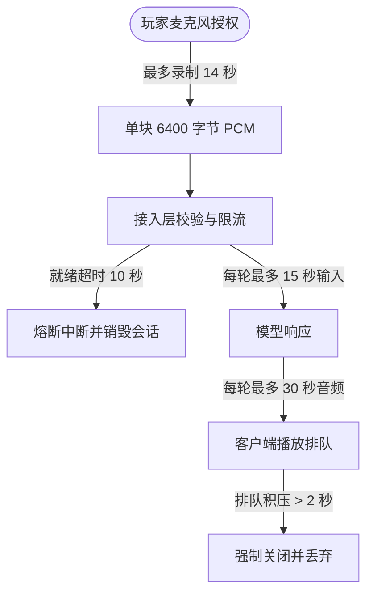

# 百炼实时语音：离线可验证的接入层

本文档记录了基于阿里云百炼（DashScope）实时语音对话协议的接入层实现、离线集成测试套件以及严格的安全隔离边界。

::: warning 离线实验状态声明

- **环境隔离**：当前实现为协议兼容适配层与离线集成测试脚本，**真实百炼实时模型在线对话、账号计费及端到端音质尚未在线联调**。
- **模拟器表现**：离线模拟器仅产生固定测试字幕、合成提示音及示例方块修改建议，不代表真实大模型生成效果。
- **生产控制台**：管理界面的语音配置中心已全面迁移至持久化的 TTS/ASR 服务管理（详见 [语音服务配置](/voice/setup.md)）。
  :::

---

## 协议验收与执行脚本

开发者可通过执行下述脚本在隔离环境中进行端到端协议一致性验证：

```bash
# 执行百炼实时对话协议集成测试
pnpm --filter @voxel/server exec tsx test/integration/realtime.ts
```

::: info 离线验证保障
该测试套件使用虚拟内存世界与固定 Mock 数据流，不发起外部真实网络请求，不消耗云端模型 Token 或付费 API 额度。
:::

---

## 协议规范与安全边界

系统遵循官方规范设计：

- [Qwen-Audio 实时语音用户指南](https://help.aliyun.com/zh/model-studio/qwen-audio-realtime-user-guides)
- [qwen-audio-3.1-realtime-plus 接口说明](https://help.aliyun.com/zh/model-studio/qwen-audio-3-1-realtime-plus)

### 1. 音频流与交互范式

- **模型基准**：华北 2（北京）地域，`qwen-audio-3.1-realtime-plus` 模型，默认音色 `longanqian_v3.1`。
- **采样规范**：输入音频严格限定为单声道 PCM16 LE / 16 kHz，输出音频为 24 kHz。
- **手动提交范式**：等待收到服务端的 `session.updated` 握手后才开始发送音频分块；发送 `input_audio_buffer.commit` 后显式发起 `response.create`。
- **串行调度**：工具调用执行结果必须在当前 `response.done` 结算后才触发下一轮模型生成，杜绝响应重叠与竞争冒险。

### 2. 环境变量配置清单

系统未来接入真实云端服务时将读取以下环境变量（当前版本不包含硬编码密钥）：

| 环境变量名                 | 默认值  | 作用与安全约束                                                          |
| :------------------------- | :------ | :---------------------------------------------------------------------- |
| `BAILIAN_REALTIME_ENABLED` | `false` | 全局总开关；必须显式置为字符串 `"true"` 才允许发起真实拨号。            |
| `BAILIAN_WORKSPACE_ID`     | `""`    | 业务空间 ID，用于构造固定官方二级域名；拒绝接受客户端传入的自定义 URL。 |
| `DASHSCOPE_API_KEY`        | `""`    | 服务端私密密钥；仅在真实模式开启时延迟读取，绝不暴露至前端。            |

### 3. 会话保护与配额熔断



- **单会话生命周期**：单次连续会话最多维持 **120 秒**，单轮最多允许 **4 次** 工具调用，最多生成 **8 个** 待确认修改建议。
- **输入截断**：尾部音频不足 100ms 的碎片直接丢弃；超出 15 秒的输入自动触发分段截断。
- **异常中断清理**：发生网络断线、页面隐藏或玩家取消时，服务端立即发送注销信号并**彻底销毁该会话上下文**，丢弃迟到音频及全部未消费建议。

---

## 场景安全沙箱工具集

实时语音对话仅暴露严格受限的只读观察与一次性受控提议工具，默认不向对话开放，须由玩家手动勾选授权：

| 沙箱工具名称             | 权限与参数约束                                                        | 安全机制与生效范围                                                                                                                         |
| :----------------------- | :-------------------------------------------------------------------- | :----------------------------------------------------------------------------------------------------------------------------------------- |
| **`observe_scene`**      | 仅查询玩家当前坐标、朝向、世界版本号以及半径 6 格内最近的 64 个方块。 | **不包含** 其他玩家身份、私聊、聊天历史或音频数据，仅供场景感知。                                                                          |
| **`propose_block_edit`** | 参数必须是有界合法整数坐标与白名单材质。                              | **仅生成有效期 30 秒的一次性修改建议**。工具本身绝对不直接修改世界。玩家手动点击批准后，方才交由服务端统一执行碰撞、版本锁与基岩碰撞核验。 |

::: warning 权限硬边界
系统**不提供**移动实体、发起公共聊天、外部 URL 访问、动态脚本执行或任意数据库访问工具。对话与模型工具均无法突破此安全白名单。
:::

### 客户端与服务端消息信令

- **上行信令 (Client -> Server)**：
  - `realtime.start`：协商握手参数（`mode`、`sceneConsent`、`audioConsent`）。
  - `realtime.audio`：传输二进制 PCM 音频切片。
  - `realtime.commit`：通知录音提交（可选附加纠错文本）。
  - `realtime.stop`：主动终止语音录制或当前生成。
  - `realtime.approve`：玩家显式确认并执行模型提出的 `proposalId` 方块建议。
- **下行事件 (Server -> Client)**：
  - `realtime`：携带会话状态流转（`ready`、`subtitle`、`audio`、`proposal`、`done`、`error`、`closed`）。所有事件仅定向发回会话所属玩家。

---

## 验证与集成记录

```bash
# 全局代码检查与单元测试
pnpm typecheck
pnpm test
pnpm build

# 运行实时语音离线集成专项回归
pnpm --filter @voxel/server exec tsx test/integration/realtime.ts
```

### 离线测试覆盖指标

1. **协议层鲁棒性**：验证开关优先于凭证访问、手动音频切片流转、工具链串行调用、建议生命周期（过期/单次消费/归属权核验）、背压控制与异常断开脱敏。
2. **多端状态同步**：在独立的 Colyseus 内存世界中，通过 2 个协议玩家与 1 个脚本 Agent 并发联调，确认跨玩家越权批准拦截、确认后的全服广播同步以及断线旧建议作废机制全部通过。
