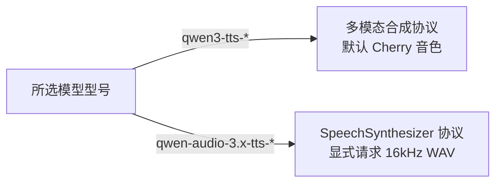
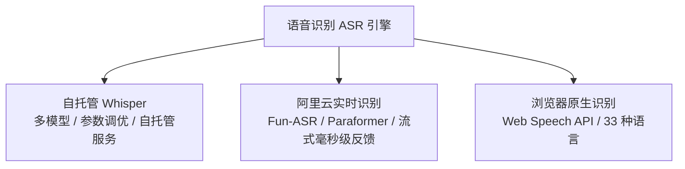

# 语音服务管理与 Agent 发声

控制台提供了统一的 **文本转语音（TTS）** 与 **语音识别（ASR）** 服务配置中心。管理员可配置多套音色与识别模型，为不同的 AI Agent 指定个性化嗓音，并在浏览器中进行低延迟试听与调试。

::: tip 核心架构概览

- **TTS 语音合成**：支持本地轻量 Piper 引擎、阿里云百炼 Qwen-TTS、兼容 OpenAI Speech API 以及前端浏览器 Web Speech 原生朗读。
- **ASR 语音识别**：支持本地自托管 Whisper、阿里云实时语音识别（Fun-ASR / Paraformer）以及前端 Web Speech 识别。
- **零秘钥泄露**：配置文件以 `0600` 权限保存在服务端，浏览器仅接收脱敏元数据（`hasApiKey: boolean`）。
  :::

---

## 文本转语音（TTS）服务矩阵

控制台左侧列出已保存的语音服务，右侧展示详情与即时试听面板。同一个服务商支持创建多份音色配置。

| 服务类型           | 运行环境与依赖                              | 支持模型与音色                                                                         | 适用场景与特性                                                          |
| :----------------- | :------------------------------------------ | :------------------------------------------------------------------------------------- | :---------------------------------------------------------------------- |
| **Piper 本地语音** | 本地 Docker 容器 (`speaches`)，无需 API Key | 中文华岩 (`huayan`)、超文 (`chaowen`)、英文 (`lessac`)；支持 0.5–2.0x 语速             | 推荐开发与私有化离线部署，零网络依赖与调用费用，单声道 16 kHz PCM WAV。 |
| **百炼语音合成**   | 阿里云 DashScope 云端 API                   | `qwen3-tts-*`（如 `qwen3-tts-flash`）与 `qwen-audio-3.1-tts-*`（如 `longanhuan_v3.1`） | 高拟真自然度中文发音，支持丰富的预设人声与情绪。                        |
| **兼容语音接口**   | 遵循 OpenAI Audio Speech 规范的网关         | 自定义 Model 与 Voice 标识                                                             | 适用于自建 vLLM、CosyVoice、ChatTTS 等第三方兼容音频推理服务。          |
| **浏览器系统语音** | 前端原生 Web Speech API (`speechSynthesis`) | 客户端操作系统内置音色（中英自动匹配）                                                 | 零后端部署成本；直接由听者本地浏览器朗读，支持静音切换。                |

---

## 引擎配置与技术规范

### 1. Piper 本地语音引擎

Piper 运行在与主服务共享的 `speaches` 容器内，模型持久化保存在 Docker 卷中，服务重启无需重新下载。

```
+-------------------------------------------------------------+
| Speaches Docker 容器 (端口 :8000)                             |
|   |-- zh_CN-huayan-medium  (默认中文女声)                    |
|   |-- zh_CN-chaowen-medium (超文高保真男声，带 g2pW 词表)    |
|   +-- en_US-lessac-medium  (标准英文女声)                    |
+-------------------------------------------------------------+
```

- **安装模型**：在控制台点击“安装”按钮，系统在后台拉取模型并校验 SHA-256。安装通常在 1–3 分钟内完成（上限 10 分钟），成功后状态更新为“已安装”。
- **超文 (Chaowen) 专有优化**：安装时自动包含 `g2pW` 中文多音字注音词表与 BERT 分词词典，保存在 `.voxel-piper/chaowen-v1` 路径下，合成时不发生动态网络请求。
- **服务地址解析**：优先读取 `SPEECH_API_URL` 环境变量，未设置时默认使用本机 `http://127.0.0.1:8000/v1`（Docker 内默认 `http://speech:8000/v1`）。
- **详细服务说明与 API 测试**：完整架构、cURL 测试用例与故障排查见 [Speaches 本地独立语音微服务说明](./speaches-service.md)。

### 2. 阿里云百炼语音合成

百炼平台依据模型族群自动适配底层协议：



- **地域节点**：支持北京（华北 2）与新加坡（国际）节点，可按需填写专属业务空间 ID。
- **脱敏保护**：试听与发声接口对鉴权失败、模型不可用、音色不匹配进行语义分类脱敏提示，防止云服务商错误日志向前端泄露 API Key 或私密试听文字。

### 3. 浏览器系统语音（Web Speech API）

- **工作机制**：完全在客户端调用 `window.speechSynthesis`。
- **动态回退**：通过 `getVoices()` 动态探测听者本地设备支持的音色。若指定音色在当前设备缺失，自动安全降级至同语言系统默认音色。
- **限制说明**：由于属于客户端本地合成，浏览器朗读无法支持 Three.js 空间音效管线的距离平方衰减与双耳声相。

---

## Agent 发声绑定与空间分发

### 绑定配置流

1. 在 **控制台 → AI 角色管理** 中创建或编辑 Agent。
2. 在 **语音服务** 下拉列表中选择已保存的 TTS 配置（或选择“关闭语音 · 仅文字回复”）。
3. 开启 `voiceReplies` 属性。
4. 在房间中的真人玩家打开右上角附近语音面板中的 **开启收听** 开关即可听到声音。

::: info 发声与权限控制原则

- **距离衰减与朝向**：声音随 Agent 实时坐标移动，严格遵循距离平方反比模型（18 格外静音，背对衰减至 35%）。
- **空间字幕气泡**：Agent 发声时，头顶同步渲染 3D 锚点投射的空间字幕气泡，带平滑进入、距离自适应缩放与渐隐动画。
- **私信严格隔离**：Agent 私聊回复合成的音频，仅向指定接收者发放临时授权，旁观者即使贴近也无法听到或下载。
- **防递归自激**：Agent 自身的朗读音频和文字不会进入其自身的 `observe` 感知上下文。
  :::

### 安全配额与熔断控制

- **文本长度限制**：每次合成最多截取 **240 字符**。
- **超时保护**：云端与本地合成调用超时硬限制为 **60 秒**，并发上限为 **2**。
- **音频缓存池**：单段音频最长 90 秒，服务器内存仅保留最近 **24 段或 32 MiB**（最长保留 **120 秒**）。排队超过 30 秒的积压合成自动丢弃，避免语音延迟雪崩。
- **持久化权限**：TTS 与 ASR 服务配置保存在 PostgreSQL；API Key 不出现在公开列表中。旧 `.data/voice-services.json` 和 `.data/asr-settings.json` 文件不会自动导入或删除。被 Agent 引用的 TTS 服务受到删除保护。

---

## 语音识别（ASR）配置

控制台右侧的 **语音识别（ASR）** 面板提供多引擎语音转写配置与实时录音试用：



### 1. 阿里云实时语音识别

- **模型选项**：`fun-asr-realtime`（默认推荐）与 `paraformer-realtime-v2`。
- **通信协议**：通过项目服务端 WebSocket 代理流式连接阿里云 DashScope，规避前端直接暴露 API Key。
- **断句与确认**：流式推送实时 `partial` 临时字幕（带智能文本纠错），收到服务端 `sentence_end` 事件时正式提交整句结果。
- **计费与适用范围**：录音经项目服务器发送给阿里云，按服务商规则计费。保存识别服务后，可分别指定聊天输入和附近语音使用的服务；聊天语音录制需要支持文件转写的 Whisper 服务。

### 2. 自托管 Whisper 引擎

识别通过独立 Speaches 服务的 `/v1/audio/transcriptions` 接口完成。模型在语音服务中下载、加载和管理，不读取项目的本地 GGML 文件。

| 参数项                     | 取值范围              | 默认值                        | 作用说明                               |
| :------------------------- | :-------------------- | :---------------------------- | :------------------------------------- |
| **识别模型**               | 语音服务支持的模型 ID | `Systran/faster-whisper-base` | 可配置其他已支持的 Faster Whisper 模型 |
| **采样温度 (Temperature)** | `0.0..1.0`            | `0.0`                         | 发送给识别接口的采样温度               |
| **提示引导词 (Prompt)**    | 最多 500 字符         | 中文引导提示词                | 引导简体中文输出或专业术语识别         |

线程数与搜索宽度由语音服务管理，项目控制台不再提供未生效的设置。

::: tip 中文转写优化
中文识别请求默认附带提示词：“_以下是简体中文的语音转写。_”，显著提升中文标点与简繁一致性。若填写了自定义提示词则优先使用自定义内容。
:::

### 3. 浏览器语音识别（Web Speech API）

- **完全本地触发**：调用浏览器 `SpeechRecognition` API，无需项目后端参与，不消耗服务器算力。
- **多语言矩阵**：内置支持全球 **33 种主要语言与方言**（普通话、粤语、英语、日语、韩语、法语、西语等）。
- **存储机制**：配置保存在当前浏览器本地存储中，最多保存 20 套预设。

---

## API 端点全集与测试套件

### REST 管理接口

```http
# TTS 服务管理
GET    /voice/tts/services              # 获取脱敏服务列表
POST   /voice/tts/services              # 创建新 TTS 配置
PUT    /voice/tts/services/:id          # 修改配置
DELETE /voice/tts/services/:id          # 删除未被引用的服务
POST   /voice/tts/services/:id/preview  # 试听合成 ({ text }) -> audio/wav

# Piper 模型管理
GET    /voice/tts/piper/models          # 查询模型列表与安装状态
POST   /voice/tts/piper/install         # 异步触发模型下载 ({ model })

# ASR 服务管理
GET    /voice/asr/services              # 获取 ASR 服务列表
POST   /voice/asr/services              # 创建 ASR 配置
PUT    /voice/asr/services/:id          # 修改 ASR 配置
DELETE /voice/asr/services/:id          # 删除 ASR 配置
WS     /voice/asr/realtime?serviceId=.. # 建立实时 ASR 识别流
```

### 验证与回归测试

```bash
# 全局类型检查与代码风格
pnpm check
pnpm format:check

# 语音服务单元与 Mock 测试
pnpm test:voice:services

# 滚动字幕与 WebSocket 联调
pnpm test:voice:live

# 挂载真实 WAV 文件测试真实 Whisper 实时速率回放
ASR_TEST_WAV=/absolute/path/mono-16khz.wav pnpm test:voice:live

# 本地 Piper 真实音频合成端到端测试（需提前安装中文模型）
REAL_TTS=1 pnpm test:voice:services
```
