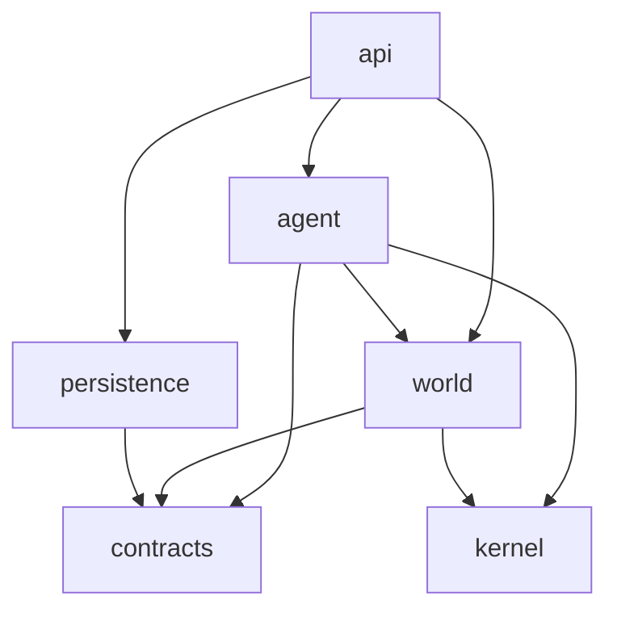

# Agent runtime

`@voxel/agent-runtime` 是 AI 角色的无头运行时：将玩家消息、控制指令、计划到期和动作结果统一为事件驱动的决策循环，驱动模型选择工具，并将工具调用转化为受权限、任务归属与预算约束的世界操作。服务端托管角色与 CLI 共用同一套实现。

包按两条能力轴切分：`world/` 只处理世界协议与物理，`agent/` 只处理角色策略与模型。`api/` 是宿主唯一接触面，`contracts/` 是纯类型叶子层，`kernel/` 提供取消与超时原语，`persistence/` 负责存档格式与版本迁移。

运行时持有角色状态、消息队列和执行槽；动作层统一管理后台执行、持续动作推进、结果事件和效果核对，核心决策循环不直接读取具体动作状态；宿主保留世界连接、计划账本、唤醒定时器及联合存档事务。

## 设计原则

新增文件放哪里，只问两个问题：

1. **它因为什么而变化**——世界协议/物理、AI 策略/模型、存档格式，还是宿主契约？
2. **它需不需要 IO**——需要就把接口留在使用方，实现放进适配器。

四条硬规则：

- **依赖单向**：只能沿 `api → agent/world/persistence → contracts/kernel` 方向 import，反向和横穿一律禁止。
- **领域无 IO**：时间、随机数、id、日志全部通过端口注入，业务规则在假时钟下可测。
- **宿主只认门面**：宿主不拼事件 id、不解析控制指令、不读写 `AgentRunState` 内部字段。
- **存档版本集中**：旧格式兼容只在 `persistence/migrate.ts`，升级必须附带旧档 fixture。

## 目录结构与职责

```
packages/agent-runtime/
├── package.json            # exports: "." 与 "./testing"
├── tsconfig.json           # 独立编译单元
├── README.md
└── src/
    ├── index.ts            # 只 export * from './api'
    ├── api/                # 宿主唯一接触面
    │   ├── index.ts        # 公共导出汇总
    │   ├── runtime.ts      # AgentRuntime / AgentRunner、单执行槽与 CLI 循环
    │   ├── execution.ts    # 任务操作、只读视图、存档与宿主生命周期
    │   ├── receive.ts      # 消息去重、持久化后入队、控制指令路由
    │   ├── intake.ts       # WorldEvent → CharacterEvent：事件 id、控制词、审计入队
    │   ├── state.ts        # 计划任务启动、历史恢复与事务回滚入口
    │   ├── standalone.ts   # runAgent 独立运行适配
    │   └── ports.ts        # RuntimePorts（session/model/store/log/state）
    ├── contracts/          # 纯类型叶子层，只依赖 @voxel/shared
    │   ├── index.ts
    │   ├── observation.ts  # Observation
    │   ├── action.ts       # AgentAction / ActionResult / BatchResult / NavigationResult
    │   ├── config.ts       # CharacterConfig / ModelConfig / LimitsConfig
    │   ├── task.ts         # TaskCommand / TaskAuthority / TaskLease / TaskOutcome
    │   ├── state.ts        # AgentRunState v3、CharacterEvent、PiCheckpoint
    │   ├── tool-state.ts   # 单次 turn 的工具状态位
    │   └── errors.ts
    ├── kernel/             # 叶子原语层：取消、超时与信号组合
    │   └── abort.ts        # cancellable / withDeadline / mergeSignals
    ├── world/              # 世界交互：不依赖 LLM 与任务策略
    │   ├── session/
    │   │   ├── port.ts     # AgentSession: observe/move/request
    │   │   └── colyseus.ts # Colyseus 会话与重连
    │   ├── observe/
    │   │   ├── extract.ts  # 观察裁剪、worldView、worldSignature
    │   │   ├── attention.ts # 过滤发给当前角色的真人消息
    │   │   └── verify.ts   # arrived / observedEmpty / 方块比对谓词
    │   ├── actions/
    │   │   ├── parse.ts    # 模型输出 → 合法动作与权限校验
    │   │   ├── execute.ts  # 单动作执行
    │   │   ├── batch.ts    # 批执行与不确定结果标记
    │   │   └── build.ts    # houseBlocks 规划 + executeBuild
    │   └── nav/{map,astar,controller}.ts
    ├── agent/              # 角色智能与任务编排
    │   ├── state/          # 角色/执行状态归属投影与恢复
    │   │   └── ownership.ts recovery.ts
    │   ├── task/           # 任务实体、命令、授权、租约、预算、事件收件箱
    │   │   └── service.ts policy.ts state.ts inbox.ts budget.ts commands.ts
    │   ├── turn/           # 一次决策的生命周期
    │   │   ├── turn.ts     # Turn 状态机：事件生命周期与动作槽，实现 ToolHost
    │   │   ├── binding.ts  # TurnBinding：单轮任务租约、预算与配置切换
    │   │   ├── wake.ts     # 执行槽与单次唤醒的事件循环
    │   │   ├── event.ts    # 事件认领与结算
    │   │   ├── prepare.ts  # 观察、跳过未变化的等待、可见任务计算
    │   │   ├── decide.ts   # 装配 Pi Agent、回放历史并接入模型流
    │   │   ├── guards.ts   # 批次边界、截断、协议纠正
    │   │   ├── health.ts   # 连续失败与无进展检测
    │   │   ├── window.ts   # 转录裁剪：只保留完整交互组
    │   │   ├── transcript.ts # 转录脱敏、按受众保留与检查点写入
    │   │   └── checkpoint.ts
    │   ├── tools/          # 模型可见能力：schema + handler
    │   │   ├── port.ts     # ToolHost 接口（由 Turn 实现）
    │   │   └── schema.ts conversation.ts world.ts task.ts
    │   ├── action/         # 任务绑定的动作生命周期
    │   │   ├── runtime.ts  # 单动作槽、持续动作推进、等待与取消
    │   │   ├── port.ts     # 本地动作推进契约
    │   │   ├── lifecycle.ts # 动作状态、租约隔离与结果事件发布
    │   │   ├── executor.ts # 租约、预算、权限与物理执行适配
    │   │   ├── effects.ts  # 动作策略与进度钩子装配
    │   │   ├── reconcile.ts # 效果恢复、观察核对与决策可见字段
    │   │   └── follow.ts build-tracker.ts chat-pacing.ts
    │   ├── prompt/{character,skills,view}.ts
    │   ├── model/{pi,stream,charge,failure}.ts
    │   └── schedule.ts     # 唤醒等待间隔策略
    ├── persistence/        # 存档格式与迁移
    │   └── migrate.ts      # v3 状态归一化与恢复
    └── testing/            # "./testing"：内存 Session、可控 Clock/Id 夹具
```

| 目录 | 职责 | 不负责 |
| --- | --- | --- |
| `api/` | 宿主门面、事件接入、只读投影、端口组装 | 决策、工具实现、世界执行 |
| `contracts/` | 跨层 DTO、存档形状、配置与错误类型 | 行为、IO、版本迁移 |
| `kernel/` | 取消、超时、信号组合原语 | 业务类型与状态 |
| `world/session/` | 会话端口与 Colyseus 实现、重连 | 任务策略、模型请求 |
| `world/observe/` | 观察提取、注意力过滤、结果核对谓词 | 写回状态、调度唤醒 |
| `world/actions/` | 动作解析、权限校验、单动作/批执行、建造 | 任务归属、模型循环 |
| `world/nav/` | 局部地图、可站立节点搜索、可取消位置闭环 | 任务状态、跟随意图 |
| `agent/state/` | 角色/执行状态拆分、v3 分区投影、事务快照恢复 | 任务规则、IO |
| `agent/task/` | 任务实体、命令与授权、租约、预算计算与提交 | 发起模型请求、执行世界写操作 |
| `agent/turn/` | 单次决策状态机、事件与转录、观察核对、守卫与检查点 | 宿主协议、具体连接实现 |
| `agent/tools/` | 工具 schema 与 handler，只依赖 `ToolHost` | 直接访问 Session、持久化细节 |
| `agent/action/` | 任务绑定的动作执行、后台动作槽、跟随推进 | 模型决策 |
| `agent/prompt/` | 系统提示词、技能指引、模型输入视图构造 | 工具执行 |
| `agent/model/` | Pi 模型配置、流式请求、请求计量与失败分类 | 工具执行、任务状态转换 |
| `persistence/` | 存档序列化与版本迁移 | 运行时决策、世界访问 |
| `testing/` | 确定性测试夹具，供包内单测和 CLI 使用 | 生产代码依赖 |

## 依赖方向



| 层 | 可以依赖 | 明确禁止 |
| --- | --- | --- |
| `contracts` | `@voxel/shared` 纯类型 | 任何实现、`node:*`、Pi / Colyseus 类型 |
| `kernel` | 无 | 其他层、业务类型 |
| `world` | `contracts`、`kernel`、`@voxel/shared` | `agent/*`、`api`、Pi SDK |
| `agent/task` | `contracts`、`kernel` | 世界执行、Pi、`node:crypto` |
| `agent/model` | `contracts`、`kernel`、`@earendil-works/*` | `agent/turn`、`api` |
| `agent/tools` | `contracts`、`prompt`、`tools/port.ts` | `turn` 实现、`api` |
| `agent/turn` | `agent/*`、`world/observe`、`contracts` | 直接调用 `world/actions/execute`（须走执行器） |
| `persistence` | `contracts` | `world`、`agent`、`api` |
| `api` | 全部（唯一组装点） | — |

`index.ts` 只导出 `api/`；包内模块使用相对路径，不通过包入口回绕。宿主只通过 `@voxel/agent-runtime`（及测试入口 `@voxel/agent-runtime/testing`）访问，不深层导入内部路径。

## 公共入口

模型服务地址由宿主提供，模型名与 API Key 由单次运行的 `config` 提供。运行时可先创建并恢复状态，再通过 `connect(session, selfId)` 接入世界。

```ts
import { createAgentRuntime } from '@voxel/agent-runtime';

const runtime = createAgentRuntime({
  session,
  selfId: session.room.sessionId,
  endpoint: { type: provider.type, baseUrl: provider.baseUrl },
  store: { save: () => save(runtime.snapshot()) },
});
await runtime.submit(message);
await runtime.run(config, { signal });
```

| 宿主场景 | 运行时方法 |
| --- | --- |
| 接收世界消息 | `receive()`（`submit()` 用于仅提交普通聊天） |
| 登记计划、启动计划执行 | `queuePlan()`、`startScheduled()` |
| 控制任务 | `control()`；联合存档事务使用 `stageControl()` |
| 读取角色视图、捕获任务记录 | `view()`、`runtimeView(snapshot)`、`executionRecord()` |
| 导出角色或执行存档 | `snapshot()`、`archive()` |
| 恢复存档与历史执行 | `restore()`、`recoverAfterRestart()`、`recoverHistory()`、`resumeExecution()` |
| 回滚宿主事务 | `rollback()` |
| 唤醒、查询下次调度间隔、中断 | `run()`、`runUntilSettled()`、`nextWakeDelay()`、`interrupt()` |

- `control()` 在校验后停止当前执行并持久化；`stageControl()` 仅同步变更内存状态，供服务端在停止执行后与任务账本一起原子保存。
- `view()` 与 `runtimeView(snapshot)` 返回脱离内部状态的只读投影；`snapshot()` 与 `archive()` 导出 v3 存档数据，宿主直接持久化，不读写内部字段。

## 执行路径与动作生命周期

### 决策循环

1. **入口**：每个托管角色持有一个 `AgentRuntime`。服务端调用 `runtime.run()` 并通过 `nextWakeDelay()` 获取下次唤醒间隔；CLI 调用 `runUntilSettled()`。重复唤醒和执行中的根状态替换会被拒绝。
2. **接入**：`receive()` 负责过滤、去重、解析控制指令和授权。普通消息先保存再入队，队列满时标记 `unknown`；保存期间连接失效的消息不进入新连接队列。授权控制指令交由宿主账本事务停止旧执行后提交；未授权控制词按普通聊天处理。
3. **唤醒**：`agent/turn/wake.ts` 由消息、任务推进、继续决策三类原因驱动；无新消息时交由 `ActionRuntime` 推进已保存的动作；后台动作未结束时等待动作完成或新消息到来，不并发发起第二次决策。
4. **决策**：`agent/turn/turn.ts` 按 `claim → prepare → decide → settle` 推进：
   - `binding.ts` 持有当前配置、预算和租约，处理聊天转任务时的预算与身份切换；
   - `prepare.ts` 观察世界并交由 `agent/action/reconcile.ts` 核对未确认效果，`agent/prompt/view.ts` 构造模型输入载荷；
   - `decide.ts` 装配 Pi Agent、回放历史并调用 `agent/model/stream.ts` 发起模型流；
   - `guards.ts` 在工具边界拦截截断、已停止、预算耗尽和失败批次。
5. **工具与执行**：`agent/tools/*` 的 handler 只依赖 `ToolHost`。`TaskService` 处理任务授权、命令与租约；世界工具将动作交给 `agent/action/executor.ts` 校验租约并执行。例如建房链路为 `agent/tools/world.ts` → `agent/action/executor.ts` → `world/actions/batch.ts` → `world/actions/execute.ts` → `world/actions/build.ts`，展开蓝图后逐块调用 `session.request('edit')`，施工过程不逐块请求模型。
6. **收尾**：任务进入结束态后清空可重放状态，`store` 原子保存 `snapshot()`。

### 动作生命周期

核心决策循环只识别动作推进的三种结果：`idle`（继续正常决策）、`stop`（结束本次唤醒）、`resume`（进入恢复决策），不直接感知 `goto`、`follow`、`build` 或 `house`。

- **后台动作（`goto` / `build` / `house`）**：占用后台动作槽，完成状态与 `action:<id>` 结果事件持久化后才释放槽位。执行期间到达的新消息可先进入决策，普通问答不会中断或重启施工。
- **持续跟随（`follow`）**：首次启动后进入等待，后续由宿主按 100ms 唤醒间隔调用 `agent/action/follow.ts` 推进本地切片，不发起模型请求；失去目标、连续停滞、权限变化或预算耗尽时发布 `action:<id>:<revision>` 失败事件并停止。
- **租约隔离与中断**：任务修订后，旧租约的完成结果和事件不会覆盖新任务；暂停与取消先中止动作并等待退出，再应用任务命令。

### 导航

`world/nav/map.ts` 管理已知空间，`astar.ts` 搜索可站立节点，`controller.ts` 执行可取消的位置闭环：

- 跳跃与下落边通过共享物理 `simulate()` 验证，普通平移检查体积与中间路径；
- 搜索每约 2ms 让出事件循环并限制扩展节点上限；局部无路不代表全局不可达；
- 暂停、取消或失败时立即中止移动，不重放历史方向输入。

## 状态与存档

内部按生命周期拆分为两类状态，序列化存档保持 v3 结构（`AgentRunState`）：

| 生命周期 | 内部类型 | 包含内容 | 对应 v3 存档字段 |
| --- | --- | --- | --- |
| 角色长期状态 | `CharacterState` | 累计用量、按受众隔离的对话、聊天节流时间、事件收件箱 | `task.usage`、`conversation.exchanges / lastChatAt`、`inbox` |
| 单次任务执行 | `TaskExecutionState` | 当前任务与租约、会话有效性、检查点、动作进度与结果、健康状态 | `task.current / identity`、`conversation.audienceExpired / lastReply`、`checkpoint`、`effects`、`health` |

- `agent/state/ownership.ts` 负责两类状态与 v3 结构之间的投影组装；`TaskPolicy` 只接收 `TaskExecutionState`，不接触角色累计用量、对话历史或收件箱。
- `persistence/migrate.ts` 的 `restoreState(raw)` 是唯一读取存档的入口（幂等，未知字段安全降级），`emptyState()` 构造初始状态，`snapshotState()` 生成不含累计 `usage` 的历史执行快照。
- **状态切换与回滚**：
  - 创建聊天任务时只替换执行状态，保留角色长期状态；
  - `startScheduled()` 启动计划任务时保留会话历史、收件箱及累计用量，重置聊天节流时间；
  - `resumeExecution()` 恢复历史执行时带回存档中的会话快照和收件箱，累计用量仍取当前角色；
  - 保存失败时回滚状态与宿主钩子修改，但保留已实际发生的模型请求计费。
- **故障恢复与预算规则**：
  - 服务启动时，执行中的任务自动转为暂停，未决动作标记为 `unknown`，**不重放**未确认的移动、聊天或世界写入；
  - 旧档升级前自动生成 `.before-character-events-v3.bak` 备份；
  - 预算只统计真实模型请求：普通事件使用独立单轮额度，绑定任务后切换为任务额度，计划排队期间不计费；
  - 默认上限：单任务 100 次调用、50,000 tokens、900,000 ms，连续 3 次失败或无进展停止自动重试。

## 模型、工具与原语边界

- **提示词与工具分离**：`prompt/` 是面向模型的提示文本，`tools/schema.ts` 是工具契约，`tools/*` 的 handler 是策略执行点，三者独立演进。
- **模型输出双重校验**：自由文本不进入动作通道；回复、任务状态和世界动作必须走各自工具。工具参数进入执行前由 `world/actions/parse.ts` 结合 `aiCharacterPermissions` 二次校验。
- **SDK 隔离**：除 `agent/model` 和 `agent/turn/decide.ts` 外，包内不出现 Pi SDK 类型；`persistence` 将转录视为不透明 JSON（`PiCheckpoint.messages: unknown[]`）。
- **取消与确定性注入**：
  - `kernel/abort.ts` 是唯一的超时与取消组合实现，提供 `withDeadline(parent, ms)`、`mergeSignals(...)` 与 `cancellable`，禁止内联复制或直接使用 `AbortSignal.any`；
  - 时间、id、随机数统一由 `ports` 注入，业务代码不直接调用 `Date.now()`、`crypto.randomUUID()` 或 `Math.random()`；
  - `agent/task/budget.ts` 只做纯计算与记账，请求计时、token 结算和错误脱敏集中在 `agent/model/stream.ts`。

## 测试与验证

包内测试夹具位于 `testing/`，覆盖任务命令与租约、预算、动作解析与建造规划、转录裁剪、事件去重、turn 状态机、存档迁移与导航闭环，不依赖真实网络和模型。

- `packages/agent-runtime/test/boundaries.test.ts`：校验分层依赖方向、无循环依赖及公共导出表面。
- `packages/agent-runtime/test/pi-runner.test.ts`：通过真实 Pi 循环与可控 SSE 响应验证预算、取消、工具顺序、受众隔离与检查点恢复。
- `packages/agent-runtime/src/world/nav/{map,astar,controller}.test.ts` 与 `packages/agent-runtime/test/navigation.test.ts`：验证确定性物理、动态障碍、未知空间及跟随调度链路。

常用验证命令（在仓库根目录运行）：

```sh
# 类型检查与代码规范
pnpm check

# 运行全部单元测试或仅运行 agent-runtime 测试
pnpm test
pnpm vitest run packages/agent-runtime

# 导航集成测试与基准测试（启动临时端口的独立内存世界）
pnpm test:navigation
pnpm bench:navigation
```

进阶与真实环境验证：

- **导航真实模型验收**：`NAVIGATION_PROVIDERS=/absolute/path/providers.json pnpm test:navigation:live`（会产生真实模型调用费用，默认使用 `deepseek`，可通过 `NAVIGATION_PROVIDER` 切换；结果写入 `artifacts/navigation-live-model.json`）。详细规则见 [统一运行时](../../docs/agent/runtime.md)。
- **CLI 多客户端集成测试**：`SERVER_URL=ws://127.0.0.1:12567 pnpm test:integration`。需连接带 PostgreSQL 持久化的独立测试世界，会修改世界固定坐标，请勿直接对正在使用的世界运行。
- **Docker 验证**：需单独构建服务端并在隔离实例或备份后验证真实模型任务、重启恢复及旧存档兼容，切勿使用 `down -v` 清空现有数据卷。
