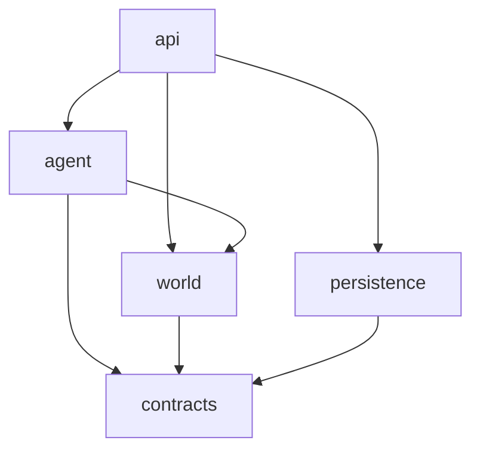

# Agent runtime

`@voxel/agent-runtime` 是 AI 角色的无头运行时：把玩家消息、控制指令、计划到期和动作结果统一成一次决策，驱动模型选择工具，再把工具结果变成受权限、任务归属与预算约束的世界操作。服务端托管角色与 CLI 共用同一套实现。

包按两条能力轴切开：`world/` 只懂世界协议与物理，`agent/` 只懂角色策略与模型。`api/` 是宿主唯一接触面，`contracts/` 是纯类型叶子层，`persistence/` 是唯一认识旧存档格式的地方。

> **状态**：角色/任务执行状态归属已分离，服务端与 CLI 已统一通过 `createAgentRuntime()` 接入。运行时持有角色状态、消息队列和执行槽；宿主保留连接、计划账本、唤醒定时器及联合存档事务。旧 `AgentRunner`、`runAgent`、`TaskService` 和 v3 存档继续兼容。

## 设计原则

新增文件放哪里，只问两个问题：

1. **它因为什么而变化**——世界协议/物理、AI 策略/模型、存档格式，还是宿主契约？
2. **它需不需要 IO**——需要就把接口留在使用方，实现放进适配器。

由此得到四条硬规则：

- **依赖单向**：只能沿 `api → agent/world/persistence → contracts` 方向 import，反向和横穿一律禁止。
- **领域无 IO**：时间、随机数、id、日志全部注入，业务规则在假时钟下可测。
- **宿主只认门面**：宿主不拼事件 id、不解析控制指令、不读写 `AgentState` 内部字段。
- **存档版本集中**：旧格式兼容只在 `persistence/migrate.ts`，升级必须附带旧档 fixture。

## 目录结构

```
packages/agent-runtime/
├── package.json            # exports: "." 与 "./testing"
├── tsconfig.json           # 独立编译单元，不依赖根 tsconfig 混编
├── README.md
└── src/
    ├── index.ts            # 只 export * from './api'
    ├── api/                # 宿主唯一接触面
    │   ├── runtime.ts      # 连接、消息入口、单执行槽与 CLI 循环
    │   ├── execution.ts    # 任务操作、只读视图、存档与宿主生命周期
    │   ├── receive.ts      # 消息去重、持久化后入队、控制指令路由
    │   ├── standalone.ts   # 旧 runAgent 签名的兼容适配
    │   ├── state.ts        # 宿主任务启动、历史恢复与事务回滚的兼容入口
    │   ├── intake.ts       # WorldEvent → CharacterEvent：事件 id、控制词、审计入队
    │   └── ports.ts        # RuntimePorts（session/model/store/log/state）
    ├── contracts/          # 纯类型叶子层，只依赖 @voxel/shared
    │   ├── observation.ts  # Observation
    │   ├── action.ts       # AgentAction / ActionResult / BatchResult / NavigationResult
    │   ├── config.ts       # CharacterConfig / ModelConfig / LimitsConfig
    │   ├── state.ts        # AgentState v3、CharacterEvent、PiCheckpoint
    │   ├── tool-state.ts   # 单次 turn 的工具状态位
    │   └── errors.ts
    ├── kernel/             # 叶子原语层：取消、超时与信号组合
    │   └── abort.ts        # cancellable / withDeadline / mergeSignals
    ├── world/              # 世界交互：不懂 LLM，不懂任务策略
    │   ├── session/
    │   │   ├── port.ts     # AgentSession: observe/move/request
    │   │   └── colyseus.ts # Colyseus 实现与重连
    │   ├── observe/
    │   │   ├── extract.ts  # 观察裁剪、worldView、worldSignature
    │   │   ├── attention.ts # 纯过滤：是否为发给自己的真人消息
    │   │   └── verify.ts   # arrived / observedEmpty / 方块比对谓词
    │   ├── actions/
    │   │   ├── parse.ts    # 模型输出 → 合法动作
    │   │   ├── execute.ts  # 单动作执行
    │   │   ├── batch.ts    # 批执行与不确定结果标记
    │   │   └── build.ts    # houseBlocks 规划 + executeBuild
    │   └── nav/{map,astar,controller}.ts
    ├── agent/              # 角色智能
    │   ├── state/          # 角色/执行状态归属投影与 v3 兼容组装
    │   │   └── ownership.ts recovery.ts
    │   ├── task/           # 实体、命令、授权、租约、预算、事件入队
    │   │   └── service.ts policy.ts state.ts inbox.ts budget.ts commands.ts
    │   ├── turn/           # 一次决策的生命周期
    │   │   ├── turn.ts     # 显式 Turn：事件生命周期与动作槽，实现 ToolHost
    │   │   ├── binding.ts  # TurnBinding：单轮任务租约、预算与配置切换
    │   │   ├── wake.ts     # AgentRunner.run：执行槽与一次唤醒的事件循环
    │   │   ├── event.ts    # 事件认领与结算
    │   │   ├── prepare.ts  # 观察、跳过未变化的等待、可见任务计算
    │   │   ├── reconcile.ts # 未确认效果与未完成建造的核对
    │   │   ├── decide.ts   # 每次决策装配 Pi Agent、调用 prompt 并接入模型流
    │   │   ├── guards.ts   # 批次边界、截断、协议纠正
    │   │   ├── health.ts   # 连续失败与无进展检测
    │   │   ├── window.ts   # 转录裁剪：只保留完整交互组
    │   │   ├── transcript.ts # 转录脱敏、按受众保留与检查点写入
    │   │   └── checkpoint.ts
    │   ├── tools/          # 模型可见能力：schema + handler
    │   │   ├── port.ts     # ToolHost 接口，由 Turn 实现
    │   │   └── schema.ts conversation.ts world.ts task.ts
    │   ├── action/         # 任务绑定的动作推进
    │   │   └── executor.ts background.ts follow.ts chat-pacing.ts
    │   ├── prompt/{character,skills,view}.ts
    │   ├── model/{pi,stream,charge,failure}.ts
    │   └── schedule.ts     # 等待间隔策略，服务端与 CLI 共用
    ├── persistence/        # 存档格式与迁移
    │   └── migrate.ts      # v3 状态归一化与恢复
    └── testing/            # "./testing"：内存 Session、假模型、可控 Clock/Id
```

## 目录职责

| 目录             | 职责                                                                 | 不负责                           |
| ---------------- | -------------------------------------------------------------------- | -------------------------------- |
| `api/`           | 门面、事件接入、只读投影、端口组装                                   | 决策、工具实现、世界执行         |
| `contracts/`     | 跨层 DTO、存档形状、配置与错误类型                                   | 行为、IO、版本迁移               |
| `world/session/` | 会话端口与 Colyseus 实现、重连                                       | 任务策略、模型请求               |
| `world/observe/` | 观察提取、注意力过滤、结果核对谓词                                   | 写回内存、调度唤醒               |
| `world/actions/` | 动作解析、权限校验、单动作/批执行、建造                              | 任务归属、模型循环               |
| `world/nav/`     | 局部地图、可站立节点搜索、可取消的位置闭环                           | 任务状态、跟随意图               |
| `agent/state/`   | 角色/执行状态拆分、v3 兼容组装、事务快照恢复                         | 任务规则、IO                    |
| `agent/task/`    | 任务实体、命令与授权、租约、预算计算；service 负责兼容与提交          | 发起模型请求、执行世界写操作     |
| `agent/turn/`    | 一次决策的状态机、事件与转录、观察与效果核对、守卫与检查点           | 宿主协议、具体连接实现           |
| `agent/tools/`   | 工具 schema 与 handler，只依赖 `ToolHost` 接口                       | 直接访问 Session、任务持久化细节 |
| `agent/action/`  | 任务绑定的动作执行、后台动作槽、跟随 tick、时间与取消原语            | 模型决策                         |
| `agent/prompt/`  | 系统提示词、技能指引、模型输入视图与决策载荷构造                     | 工具执行                         |
| `agent/model/`   | Pi 模型配置、OpenAI Completions 请求流、请求计量与失败处理           | 工具执行、任务状态转换           |
| `persistence/`   | 存档序列化与版本迁移                                                 | 运行时决策、世界访问             |
| `testing/`       | 确定性夹具，供包内单测和 CLI 使用                                    | 生产代码依赖                     |

## 依赖方向



箭头表示允许的 import 方向，反向一律禁止。具体约束：

| 层            | 可以依赖                                   | 明确禁止                                     |
| ------------- | ------------------------------------------ | -------------------------------------------- |
| `contracts`   | `@voxel/shared` 的纯类型                   | 任何实现、`node:*`、Pi / Colyseus 类型       |
| `kernel`      | 无                                         | 其他层、业务类型                             |
| `world`       | `contracts`、`kernel`、shared              | `agent/*`、`api`、Pi SDK                     |
| `agent/task`  | `contracts`、`kernel`                      | 世界执行、Pi、`node:crypto`                  |
| `agent/model` | `contracts`、`kernel`、`@earendil-works/*` | `agent/turn`、`api`                          |
| `agent/tools` | `contracts`、`prompt`、`tools/port.ts`     | `turn` 实现、`api`                           |
| `agent/turn`  | `agent/*`、`world/observe`、`contracts`    | 直接调用 `world/actions/execute`（走执行器） |
| `persistence` | `contracts`                                | `world`、`agent`、`api`                      |
| `api`         | 全部（唯一组装点）                         | —                                            |

`index.ts` 只导出 `api/`；包内模块用相对路径，不通过入口回绕。服务端与 CLI 不深层导入包实现。

## 执行路径

1. **入口**：每个托管角色持有一个 `AgentRuntime`；宿主调用 `runtime.run()`，内部仍走同一套 `AgentRunner`/`Turn`。重复唤醒和执行中的根状态替换被拒绝。CLI 调用 `runUntilSettled()`，旧 `runAgent()` 也适配到该入口。
2. **接入**：`receive()` 负责过滤、去重、解析控制指令和授权。普通消息先保存再入队，队列满时标记 `unknown`；保存期间连接失效的消息不进入新连接队列。授权控制交给宿主的账本事务回调，停止旧执行后再提交；未授权控制词仍按普通聊天处理。旧 `submit()` 保持仅提交聊天的布尔返回值。
3. **唤醒**：`agent/turn/wake.ts` 用消息、任务推进、继续决策三种原因驱动循环；有已保存的跟随意图且无新消息时推进一次本地跟随；后台动作未结束时等它结束或等新消息，不并发发起第二次决策。
4. **决策**：`agent/turn/turn.ts` 按 `claim → prepare → decide → settle` 推进；`binding.ts` 持有当前配置、预算和租约，并处理聊天转任务时的切换。`prepare.ts` 观察世界并交给 `reconcile.ts` 核对未确认效果，`agent/prompt/view.ts` 构造模型输入载荷。`decide.ts` 每次创建 Pi Agent、回放已保存的历史、调用 `prompt()`，其 `streamFn` 直接调用 `agent/model/stream.ts` 的 `streamModel()`；`guards.ts` 在工具边界拦截截断、已停止、预算耗尽和失败批次。
5. **工具**：`agent/tools/*` 的 schema 是模型契约，handler 只依赖 `ToolHost`（定义在 `tools/port.ts`，由 `Turn` 实现）。`TaskService` 处理任务授权、命令与租约；世界工具把动作交给执行器。
6. **动作**：`agent/action/executor.ts` 在执行时校验租约并保存进度。`goto`/`build`/`house` 作为后台动作运行，由 `agent/action/background.ts` 跟踪，结束后记录 `action_result` 事件；`follow` 由 `agent/action/follow.ts` 推进，不请求模型。
7. **收尾**：任务进入结束态后清空可重放状态，`snapshot()` 提供只读投影，`store` 原子保存。宿主只持久化投影，不解析内部字段。

建房工具的执行链是 `agent/tools/world.ts` → `agent/action/executor.ts` → `world/actions/batch.ts` → `world/actions/execute.ts` → `world/actions/build.ts`。工具绑定当前任务，执行器校验租约并保存进度，世界动作层展开蓝图并逐块调用 `session.request('edit')`；逐块施工不会逐块请求模型。

headless 场景由 `AgentRuntime.runUntilSettled()` 驱动，保留 CLI 原有的初始目标和 waiting 状态等待规则。服务端使用 `nextWakeDelay()` 获得唤醒间隔；宿主不再读取跟随意图或检查点来决定调度。

## 公共入口

模型服务由宿主提供，模型名与 API Key 由本次运行的 `config` 提供。运行时可先创建和恢复状态，再通过 `connect(session, selfId)` 接入世界。

```ts
import { createAgentRuntime } from '@voxel/agent-runtime';

const runtime = createAgentRuntime({
  session,
  selfId: session.room.sessionId,
  endpoint: { type: provider.type, baseUrl: provider.baseUrl },
  store: { save: () => save(runtime.snapshot()) },
});
await runtime.submit(message);
await runtime.run(config, { signal });
```

| 宿主需要做什么 | 运行时入口 |
| --- | --- |
| 接收世界消息 | `receive()`；`submit()` 保持旧聊天入口 |
| 登记计划、启动一次执行 | `queuePlan()`、`startScheduled()` |
| 控制任务 | `control()`；联合存档事务使用 `stageControl()` |
| 查看角色状态、捕获任务记录 | `view()`、`executionRecord()` |
| 保存角色或执行存档 | `snapshot()`、`archive()` |
| 恢复存档与历史执行 | `restore()`、`recoverAfterRestart()`、`recoverHistory()`、`resumeExecution()` |
| 回滚宿主事务 | `rollback()`，按原场景选择原地恢复或替换根状态 |
| 唤醒与停止 | `run()`、`nextWakeDelay()`、`interrupt()` |

`control()` 在校验后停止执行并持久化。`stageControl()` 只同步变更状态，供服务端在停止执行后与任务账本一起保存，不自行发起第二次存档或改变 `storageRevision` / 通知时序。`receive()` 的控制回调沿用宿主既有的命令去重、停止执行和联合提交流程。

`view()` 和 `runtimeView(snapshot)` 是脱离内部状态的读取投影；`snapshot()` 和 `archive()` 是保持 v3 格式的恢复数据。宿主可以保存和传回这些存档，但不解析或修改其中的分区。`Job.memory/attention` 及原运行时导出只作为兼容入口保留，生产宿主使用运行时方法；边界测试防止重新导入底层任务服务或深入读写运行时分区。

- `AgentRunner.run()`、`runAgent()`、`TaskService`、既有状态助手和 `RuntimePorts` 继续可用。可在 `run()` 注入旧 Runner 工厂，保留提供商选择和测试夹具。
- 包内测试与 CLI 夹具使用 `@voxel/agent-runtime/testing`，不复制生产实现。
- `exports` 仍只有 `.` 和 `./testing` 两个入口。

## 状态与存档

内部按生命周期区分两类状态；公开的 `AgentRunState` 和存档仍保持 v3 字段布局，不引入第二份持久化状态：

| 生命周期 | 类型 | 内容 |
| -------- | ---- | ---- |
| 角色长期状态 | `CharacterState` | 累计用量、按受众保存的对话、聊天节流时间、事件收件箱 |
| 单次任务执行 | `TaskExecutionState` | 当前任务与租约、执行会话有效性、检查点、动作进度与结果、执行健康状态 |

`agent/state/ownership.ts` 是两种归属与 v3 布局之间的适配层。它产生短期使用的状态投影，不缓存副本；任务、动作、用量等数据保持原有引用。`TaskPolicy` 只接收执行状态，不能访问角色累计用量、对话历史或收件箱。`TaskService` 保持原有构造函数和方法，负责将同步策略结果写回兼容状态，以及持久化提交和失败回滚。

创建聊天任务时只替换执行状态，保留角色状态及宿主持有的根对象引用。暂停、取消、修订和完成仍使用原来的任务规则与动作核对。保存失败时回滚两类状态及宿主 hook 的修改，但保留已产生的模型请求用量。

宿主通过运行时的 `startScheduled()`、`resumeExecution()`、`rollback()` 处理状态切换；旧状态助手继续兼容。保持两项既有行为：计划任务启动保留会话历史、收件箱及累计用量，但重置聊天节流时间；历史执行恢复带回存档中的会话快照和收件箱，累计用量仍取当前角色。后者若要改为始终使用最新会话，应作为独立行为变更处理。

v3 兼容字段与内部归属的对应关系：

| 兼容字段 | 归属 |
| -------- | ---- |
| `task.usage` | 角色累计用量 |
| `conversation.exchanges / lastChatAt` | 角色会话与聊天节流 |
| `inbox` | 角色收件箱与审计记录 |
| `task.current / identity` | 当前任务执行与租约 |
| `conversation.audienceExpired / lastReply` | 执行关联的会话状态 |
| `checkpoint / effects / health` | 执行检查点、动作与健康状态 |

`persistence/migrate.ts` 的 `restoreState(raw)` 是唯一读取旧档的入口（idempotent，未知输入降级为空分区），`emptyState()` 构造完整 v3 分区，`snapshotState()` 生成不含 `usage` 的历史运行快照。现有调用方持有的 `memory` 引用在 `TaskService` 启动新任务或回滚后仍然有效；宿主主动切换历史执行时仍按原有约定替换根对象。

规则：

- 启动时执行中的任务转为暂停，执行中的动作标记 `unknown`，**不重放**未知效果的聊天或移动。
- 检查点与事件队列随宿主存档持久化；旧档升级前生成 `.before-character-events-v3.bak` 备份。
- 预算只统计真实模型请求：一次事件使用独立额度，附着任务后切换到任务额度；这是取值，不是原地修改配置对象。排队不创建运行时任务，也不计费。
- 默认上限：单任务 100 次调用、50,000 tokens、900,000 ms；连续 3 次失败或无进展即停止自动重试。角色可在控制台调整。

## 模型与工具边界

- `prompt/` 是面向模型的产品文本；`tools/schema.ts` 是模型契约；`tools/*` 的 handler 是策略执行点。三者分开演进。
- 模型输出永远是数据：进入执行前由 `world/actions/parse.ts` 再校验一次，权限来自 shared 的 `aiCharacterPermissions`，与工具 schema 形成双重防线。
- 除 `agent/model` 和 `agent/turn/decide.ts` 外，包内不出现 Pi SDK 类型；`persistence` 把转录当不透明 JSON（`PiCheckpoint.messages: unknown[]`）。
- 自由文本不进入动作通道；回复、任务状态和世界动作必须走各自工具。

## 时间、取消与预算

- `kernel/abort.ts` 是唯一的超时与取消组合实现，对外提供 `withDeadline(parent, ms)`、`mergeSignals(...)` 与 `cancellable`；禁止再写内联副本或直接用 `AbortSignal.any`。
- 时间、id、随机数通过 `ports` 注入；业务代码不直接调用 `Date.now()`、`crypto.randomUUID()` 或 `Math.random()`。
- `agent/task/budget.ts` 只做计算与记账；请求边界上的计时、token 结算和脱敏在 `agent/model/stream.ts`。

## 测试与验证

包内测试覆盖纯规则与状态机：任务命令与租约、预算、动作解析与建造规划、转录裁剪、事件去重、turn 状态迁移、存档往返与旧档迁移。测试夹具在 `testing/`，不依赖真实网络和真实模型。

`packages/agent-runtime/test/boundaries.test.ts` 检查依赖方向与循环依赖，`packages/agent-runtime/test/pi-runner.test.ts` 通过真实 Pi 循环与可控模型响应检查预算、取消、工具顺序、隔离和检查点恢复。`tests/support/model-fixture.ts` 只把测试指定的工具调用编码成模型 SSE 响应；业务用例通过真实 `AgentRunner` 执行，不再维护独立的 JSON 决策执行器。

在仓库根目录运行：

```sh
pnpm check
pnpm test
pnpm vitest run packages/agent-runtime
```

模型及语音集成使用 fixtures，不能替代真实服务验证；`apps/server/test/task-service.test.ts` 覆盖修订、保存失败和旧存档迁移。

CLI 多客户端回归 `pnpm test:integration` 会连接 `SERVER_URL` 指向的现有世界并编辑固定坐标，且要求 PostgreSQL 持久化。必须先准备独立测试世界，再显式设置地址，例如 `SERVER_URL=ws://127.0.0.1:12567 pnpm test:integration`，不要直接对正在使用的世界运行。

Docker 验证需单独构建服务端，在隔离实例或短暂停机备份后验证真实模型任务、重启恢复及旧存档兼容。不要用 `down -v` 清空现有数据卷。

## 导航

`world/nav/map.ts` 管理已知空间，`astar.ts` 搜索可站立节点，`controller.ts` 执行可取消的位置闭环。跳跃/下落边通过共享 `simulate()` 验证；普通平移检查体积与中间路径。搜索每约 2ms 让出事件循环，并限制扩展节点数量。局部无路不表示全局不可达。

`agent/action/follow.ts` 在宿主唤醒时推进已保存的跟随意图，不发起模型请求。新消息仍走正常任务归属流程；暂停/取消中止动作，失败时停止，不重放历史方向输入。

验证：`pnpm test:navigation` 启动临时端口的独立内存世界，覆盖真实 WebSocket 和服务端物理；`pnpm bench:navigation` 报告本机地图构建及搜索耗时。`packages/agent-runtime/src/world/nav/{map,astar,controller}.test.ts` 覆盖确定性物理、动态障碍、未知空间和取消；`packages/agent-runtime/test/navigation.test.ts` 覆盖 Pi 到跟随调度的跨模块链路。

真实模型验收：`NAVIGATION_PROVIDERS=/absolute/path/providers.json pnpm test:navigation:live`。显式读取已有服务配置并产生真实模型费用，在隔离的 Colyseus 世界向托管角色私聊“到我这里来”，断言任务创建、绕墙/上台阶、实际到达和持久化完成；每场景至多 8 次请求；另验收持续跟随期间不请求模型、普通问答保留任务及独立计费、修改目标后实际到达。默认使用 `deepseek` 服务，可用 `NAVIGATION_PROVIDER` 选择其他已配置服务。结果写入忽略目录 `artifacts/navigation-live-model.json`，不输出凭据。详细规则见 [统一运行时](../../docs/agent/runtime.md)。

## 附录：旧路径对照

| 旧路径                                                     | 新路径                                                        |
| ---------------------------------------------------------- | ------------------------------------------------------------- |
| `runtime/agent-runner.ts`                                  | `api/runtime.ts` + `agent/schedule.ts`                        |
| `runtime/character-runner.ts`                              | `agent/turn/wake.ts` + `agent/turn/turn.ts`                   |
| `runtime/decision-loop.ts`                                 | `agent/turn/decide.ts` + `guards.ts`                          |
| `runtime/{world-tools,task-control-tools}.ts`              | `agent/tools/{world,conversation,task}.ts`                    |
| `runtime/{task-executor,background-action,follow-step}.ts` | `agent/action/{executor,background,follow}.ts`                |
| `perception/observation.ts`                                | `world/observe/{extract,verify}.ts` + `agent/turn/prepare.ts` |
| `perception/{attention,chat-context}.ts`                   | `world/observe/attention.ts` + `api/intake.ts`                |
| `runtime/{decision-payload,options,turn-context}.ts`       | `agent/prompt/view.ts` + `agent/turn/turn.ts`                 |
| `cognition/{prompts,skill-guidance}.ts`                    | `agent/prompt/{character,skills,view}.ts`                     |
| `cognition/{context,checkpoint,tool-schemas}.ts`           | `agent/turn/{window,checkpoint}.ts`、`agent/tools/schema.ts`  |
| `models/*`                                                 | `agent/model/*`                                               |
| `transport/session.ts`、`transport/cancellable.ts`         | `world/session/colyseus.ts`、`kernel/abort.ts`                |
| `task/*`                                                   | `contracts/state.ts` + `agent/task/*` + `persistence/*`       |
| `actions/*`、`actions/navigation/*`                        | `world/actions/*`、`world/nav/*`                              |
| `contracts.ts`、`errors.ts`                                | `contracts/*`                                                 |

迁移顺序：先做无行为变化的搬迁与出口收敛，再统一时间/取消原语与接入层，最后处理 `AgentState` 分区与 `Turn` 对象化。每一步都保持 `pnpm check` 与既有集成测试通过。
